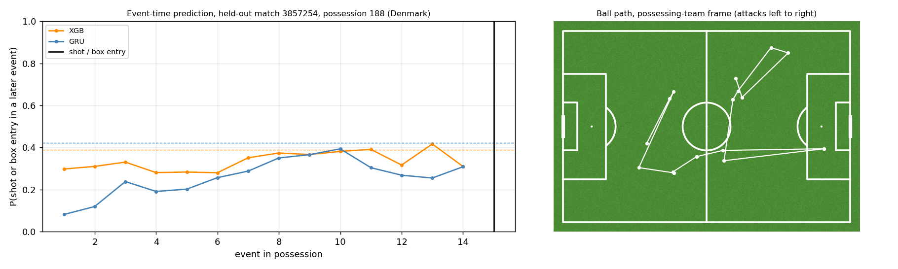

# Frame2Threat

**Can the events of an unfolding possession warn an analyst of a later shot or penalty-area entry?**

Frame2Threat answers this with StatsBomb Open Data. After every event in a possession, it estimates
the probability that the possessing team will still produce a shot or box entry. A CLI and a
Streamlit dashboard replay held-out possessions and show where an alert first fires.



*A held-out Denmark possession (match 3857254). Left: XGBoost and GRU probabilities after each event, with
their alert thresholds; the black line is the shot or box entry. Regenerate with `make demo`.*

## Status at a glance

| | |
|---|---|
| **Maturity** | Research prototype for tactical review. Not a live service, not a betting model. |
| **Primary task** | Event-time (prospective) danger prediction: at event `t`, use events `0..t` only. |
| **Data** | StatsBomb Open Data: 99 matches (64 World Cup 2022, 35 Barcelona La Liga 2020/21); 15 held-out test matches. |
| **Headline result** | ROC AUC about **0.66**, and it held on two sealed external holdouts scored once (Euro 2024: 0.662 for both models; Euro 2020: XGBoost 0.667, GRU 0.659). Modest, and most of the signal is ball position: against a **nonlinear position-only baseline the lift shrinks to about 0.01 to 0.02 AUC**, and on the 15 in-cohort test matches it is **not distinguishable from zero**. |
| **Hosted CI** | Defined in `.github/workflows/ci.yml` but **not running** (billing). The same gates were run locally: [local CI record](reports/repro/local_ci.md). |
| **Biggest open risk** | Small, selective cohort (64 World Cup 2022 plus 35 Barcelona La Liga 2020/21 matches), random match holdout, test set inspected repeatedly. The two external holdouts are men's international tournaments, close in kind to the World Cup in training; no club league outside the cohort, other season, temporal or women's validation yet. |

## Results you can quote

Event-time models, held-out test matches, 500-resample match-bootstrap 95% CI
([full retrain report](reports/repro/repair_retrain/event_time_results.md)). Every claim and its status is listed in
[reports/CLAIMS.md](reports/CLAIMS.md):

| Model | All-snapshot ROC AUC | One snapshot per possession |
|---|---|---|
| Ball x/y logistic baseline | 0.642 [0.622, 0.661] | 0.695 |
| Events-so-far logistic baseline | 0.561 [0.523, 0.603] | 0.608 |
| Start-context XGBoost | 0.590 | 0.598 |
| **Event-time XGBoost** | **0.665** [0.647, 0.681] | 0.736 |
| **Event-time GRU** | **0.664** [0.642, 0.687] | 0.739 |

The lift over the ball x/y baseline is small (about 0.02 AUC). Thresholds and hyperparameters were chosen on
validation only. The committed models come from an earlier training run and re-score at 0.6649 (XGBoost) and 0.6636 (GRU)
([artefact check](reports/repro/artefact_check.md), `make verify`).

### Sealed external holdouts and a stronger baseline

The committed models, thresholds and features, unchanged, were scored **once** on two unseen competitions, each
under a protocol committed before scoring: UEFA Euro 2024 ([protocol](reports/repro/sealed_holdout_protocol.md),
[result](reports/repro/sealed_holdout.md)) and UEFA Euro 2020 ([protocol](reports/repro/second_holdout_protocol.md),
[result](reports/repro/second_holdout.md), [JSON](reports/repro/second_holdout.json)). The second protocol also
adds a **position-only boosted baseline** (XGBoost on ball x/y, distance and angle to goal and pitch zone; no event
history; same tuning budget, fitted on the original training matches). It was added after the Euro 2024 scoring
and frozen before it was scored anywhere.

All-snapshot ROC AUC, 500-resample match bootstrap:

| | Euro 2020 | Euro 2024 | In-cohort test (15 matches) |
|---|---|---|---|
| Event-time XGBoost | 0.667 [0.654, 0.681] | 0.662 [0.650, 0.674] | 0.664 [0.646, 0.680] |
| Event-time GRU | 0.659 [0.647, 0.671] | 0.662 [0.650, 0.674] | 0.662 [0.641, 0.686] |
| Ball x/y logistic baseline | 0.639 [0.629, 0.650] | 0.641 [0.631, 0.652] | 0.641 [0.618, 0.660] |
| Position-only boosted baseline | 0.648 [0.638, 0.658] | 0.650 [0.640, 0.661] | 0.653 [0.629, 0.673] |
| XGBoost minus boosted baseline | 0.020 [0.014, 0.026] | 0.012 [0.005, 0.018] | 0.011 [-0.003, 0.023] |
| GRU minus boosted baseline | 0.011 [0.002, 0.022] | 0.012 [0.004, 0.019] | 0.010 [-0.013, 0.028] |

- **AUC 0.66 generalised** to both tournaments by the pre-specified rule (0.665 inside every interval).
- **The lift shrinks against the stronger baseline**: it holds on both tournaments, but on the in-cohort test
  matches it is not distinguishable from zero. Part of the earlier "0.02 over ball position" was the linear
  baseline's inability to model the goal's geometry.
- On Euro 2020 the GRU ranks slightly below XGBoost (difference -0.009 [-0.016, -0.000]).
- **Calibration is not reliable**: ECE (snapshot-weighted, absolute probability) is 0.039 in-cohort, 0.063 / 0.062 on
  Euro 2024 and 0.031 / 0.030 on Euro 2020, where both baselines are better calibrated (0.019 and 0.022).

The in-cohort column re-scores the committed models with today's code (0.6639 / 0.6623); the documented 0.6649 /
0.6636 came from an earlier build of the inputs, and the cause of that small difference is still open
([CLAIMS.md](reports/CLAIMS.md)).

### Alerts and operating points

With the frozen definitions ([test](reports/repro/frozen_metrics_test.json),
[Euro 2024](reports/repro/sealed_holdout.json), [Euro 2020](reports/repro/second_holdout.json)), at the
validation-prevalence threshold:

| | XGBoost, test | GRU, test | XGBoost, Euro 2024 | GRU, Euro 2024 | XGBoost, Euro 2020 | GRU, Euro 2020 |
|---|---|---|---|---|---|---|
| Precision / recall (snapshots) | 0.552 / 0.520 | 0.554 / 0.518 | 0.575 / 0.506 | 0.576 / 0.511 | 0.529 / 0.520 | 0.527 / 0.501 |
| False-alert rate: safe possessions with at least one alert | 48.0% | 39.7% | 45.2% | 39.3% | 45.4% | 37.2% |
| Median lead time before the event | 9 events | 10 events | 10 events | 10 events | 10 events | 11 events |

A **precision-oriented operating point** (target precision 0.65, threshold chosen on validation only) exists for
XGBoost only (threshold 0.574): on Euro 2020 it gives precision 0.728, recall 0.050 and a 6.6% false-alert rate
(test: 0.699, 0.069, 8.5%), and it alerts on 38.8% of dangerous possessions with a median lead of 4 events. **No
GRU threshold reaches 0.65 precision on validation.**

At the default threshold an alert fires on 37% to 48% of safe possessions. The score is a **ranking aid for
replay review, not a calibrated probability**.

Secondary results: event-only pass progression re-scores at ROC AUC 0.7337 and 0.7380 with 360 freeze frames
(small lift, 52% coverage). Retrospective whole-possession models reach AUC 0.96 to 0.98 but use completed
summaries, so they are diagnostics and **not** early-warning evidence.

## What is predicted

At completed event `t`, before any qualifying danger event:
`P(shot or box entry in later events of this possession | observed events 0..t)`.

A possessing-team shot, an event in the box, or a pass ending in the box realises the outcome, and scoring then
stops. **An incomplete pass ending in the box also counts.** This is an attempted-entry proxy, not controlled entry.
Pass end locations are only known after the pass completes, so the task never predicts pass choice.

## Quickstart

Python 3.11 or 3.12. Install CPU torch first, then the package:

```bash
python -m pip install torch --index-url https://download.pytorch.org/whl/cpu
python -m pip install -e ".[dev]"
make check        # lint, format, types, tests: everything CI would run
make dashboard    # opens on the Possession Inspector
```

On a bare clone the data is absent (`data/` is not committed), so the dashboard shows an explicit **DEMO MODE**
banner with placeholder scores: nothing shown there is football evidence. To see real results, build the
event-time inputs once (needs network; StatsBomb Open Data; this reads the fixed manifest of 99 matches), then
replay held-out possessions with the committed models:

```bash
python scripts/prepare_event_time.py --output-dir data/processed
make dashboard
frame2threat sample-possession -o poss.json --dangerous 1
frame2threat score-live poss.json --model gru -o scores.csv
```

`make verify` additionally needs the pass-level research tables (pass instances, 360 geometry), which are built by a
different route; see [REPRODUCIBILITY.md](REPRODUCIBILITY.md). Retraining overwrites models, so use a separate
`--output-dir` (explained there).

`make help` lists every target. Full instructions, including retraining: [REPRODUCIBILITY.md](REPRODUCIBILITY.md).

## Repository map

| Path | What is there |
|---|---|
| `src/data`, `src/features`, `src/labels` | Parsing, coordinates, causal features, targets. |
| `src/models`, `src/evaluation` | Training, metrics, bootstrap, calibration. |
| `src/app` | CLI (`frame2threat`) and the Streamlit dashboard (`app.py`). |
| `scripts/` | Pipeline, verification, analysis and audit scripts; see [scripts/README.md](scripts/README.md). |
| `configs/` | Pipeline configs and the fixed train/validation/test match manifest. |
| `models/` | Current model files (`.pt`, `.joblib`) plus metadata. |
| `reports/` | Results, model cards, figures and audit trail. Start at [reports/README.md](reports/README.md). |
| `tests/` | Synthetic regression and integration tests; real-data tests skip when data is absent. |
| `docs/` | Case study and demo report. |

## Research branches and limitations

| Branch | Status and scope |
|---|---|
| Event-time XGBoost / GRU | Primary task: causal features, match holdout, two sealed external holdouts, baselines and uncertainty. Lift over a nonlinear position-only baseline is small (about 0.01 to 0.02 AUC) and not shown in-cohort; probabilities are not calibrated. |
| Event-only pass progression | Secondary, post-pass prediction on `progression_beyond_pass_k`. |
| 360 spatial augmentation | Secondary ablation: small lift, incomplete and competition-dependent coverage. |
| Line-break detection | Geometric heuristic, not independently validated tactical ground truth. |
| Possession XGBoost / GRU / ensemble | Retrospective diagnostics; completion features overlap with outcomes. |
| GNN | Exploratory graph-only diagnostic, not a like-for-like feature comparison. |
| Player attribution | Exploratory retrospective explanation, not causal player value or a scouting ranking. |
| Threat gain | Unvalidated zone-value proxy; excluded from headline claims. |

## Roadmap and what blocks production

No latency, feed-revision, clock-synchronisation, odds-linkage, market-calibration or monitoring study has been
done. Before any commercial use:

1. ~~A sealed holdout of unseen competitions, scored once.~~ Done for two men's tournaments, Euro 2024 and
   Euro 2020 ([results](reports/repro/second_holdout.md)); AUC 0.66 held on both, but the lift over a nonlinear
   position-only baseline is only about 0.01 to 0.02. Still needed: club leagues outside the cohort (for example
   1. Bundesliga 2023/24), other seasons, and a model that beats the position baseline clearly.
2. Time-ordered and leave-one-competition-out validation.
3. A strict "controlled entry" label ablation next to the attempted-entry label.
4. An analyst pilot measuring whether alerts save review time.
5. Hosted CI restored, plus experiment tracking and data versioning.

## History and audit trail

The project was self-audited in October and November 2026. Several earlier results were found to be leaky and
are **withdrawn** (fraction-prefix early forecasting, AUC 0.82 to 0.85; the first event-time 0.668/0.670; the
self-determining pass label). Do not reuse them. The full story, reports and before/after evidence are in
[reports/audit/](reports/audit/README.md); the current repair is described in
[REPAIR_REPORT.md](reports/audit/REPAIR_REPORT.md). The exploratory notebooks were removed from `main` and remain in
git history up to commit `15e8ec4`.

Data attribution: [StatsBomb Open Data](https://github.com/statsbomb/open-data). Follow its licence and attribution
requirements when distributing data or derived examples. Pickle and joblib files must only be loaded from trusted sources.
