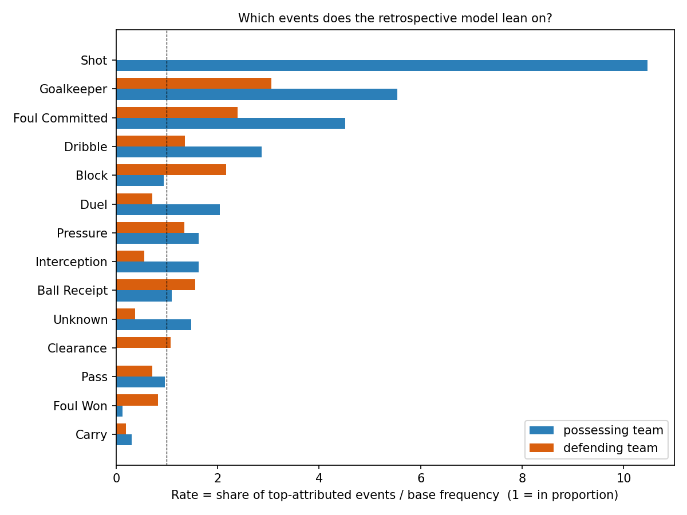
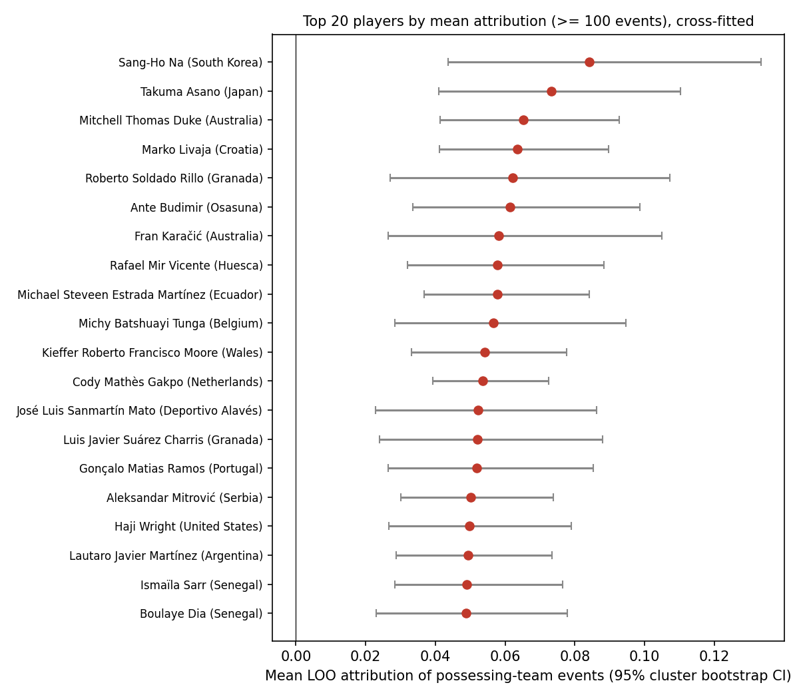
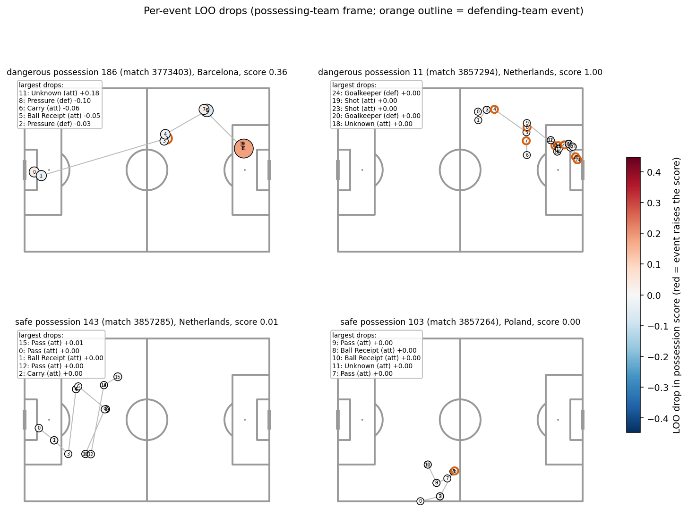

# Retrospective attribution report (cross-fitted)

Generated by `scripts/run_attribution.py` (EXP-031).  Everything here is **retrospective**: the model
sees the whole possession (first 40 events) and is asked which events it relies on.  It is not a
forecast and not causal credit.

## 1. Method

- Data: the corrected possession table (frame-fixed labels, xG and goals populated), 17,065 possessions
  from 99 matches (64 World Cup 2022, 35 La Liga 2020/21 Barcelona).
- **Cross-fitting.** The 99 matches are split into 5 match-grouped folds (seed 42).  For each fold a
  v2 GRU (`configs/model_gru.yaml`: 1 layer, hidden 64, lr 1e-3, early stopping on validation AUC, the same
  class-weighted loss as v2) is trained on the other four folds, with an inner match-level split (15% of the
  matches) for early stopping.  LOO attribution is computed **only** on the held-out fold, so every possession
  is attributed by a model that never saw that possession or any other possession of its match
  (`tests/test_attribution.py` checks this).  The v2 numbers (leaderboards, Gini 0.495) were in-sample.
- **LOO drop** = score(full possession) - score(possession with event *t* replaced by an all-zero vector).
  Events beyond the 40th are not seen by the GRU and are not attributed (14.6% of possessions are longer).
- Scores are GRU outputs trained with class weighting, so they rank possessions well but are **not calibrated
  probabilities**; attribution values are in score units.
- 310,726 attributed events, of which 84.4% were performed by the possessing team and the rest by
  the defending team (their coordinates are stored in the opposite frame; the v2 GRU input was left unchanged).

## 2. Cross-fitted accuracy (retrospective)

| fold | held-out ROC AUC |
|---|---|
| fold 0 | 0.9558 |
| fold 1 | 0.9569 |
| fold 2 | 0.9543 |
| fold 3 | 0.9572 |
| fold 4 | 0.9584 |
| pooled (all 17,065 possessions) | 0.9525 |

Pooled out-of-fold ROC AUC **0.952** (retrospective, full-possession input: not an early-warning figure).
The second cross-fitting round (seed 43) gave a pooled 0.955.

## 3. Sanity checks against real outcomes

- Possession score vs possession xG: Spearman **0.501**, Pearson 0.314 (17,065 possessions).
- Mean LOO of events in goal-scoring possessions (300) vs dangerous non-goal possessions (4,524):
  all events +0.0346 vs +0.0233;
  possessing-team events +0.0242 vs +0.0209.
- Gini of |LOO| per possession (concentration of attribution; 0 = spread evenly, 1 = one event): median
  **0.629** for dangerous possessions (IQR 0.483-0.764),
  **0.434** for safe ones (IQR 0.294-0.547); overall median 0.478.
  (v2's in-sample figure was 0.495; the definition here is on |LOO| over the attributed events.)

## 4. Event-type table (possessing vs defending team)

Rate = share of each possession's single top-attributed event (positive drops only) / base frequency of that
event type and side among all attributed events.  Rows with at least 200 events.

| event_type | side | n_events | mean_loo | mean_abs_loo | base_freq | share_top | rate |
|---|---|---|---|---|---|---|---|
| Shot | possessing team | 1,827 | +0.3351 | 0.3352 | 0.0059 | 0.0616 | 10.47 |
| Goalkeeper | possessing team | 319 | +0.0679 | 0.0722 | 0.0010 | 0.0057 | 5.54 |
| Foul Committed | possessing team | 424 | +0.1222 | 0.1317 | 0.0014 | 0.0062 | 4.52 |
| Goalkeeper | defending team | 1,818 | +0.2416 | 0.2431 | 0.0059 | 0.0179 | 3.06 |
| Dribble | possessing team | 2,277 | +0.0333 | 0.0426 | 0.0073 | 0.0210 | 2.87 |
| Foul Committed | defending team | 1,969 | +0.0184 | 0.0238 | 0.0063 | 0.0152 | 2.39 |
| Block | defending team | 2,450 | +0.0554 | 0.0868 | 0.0079 | 0.0171 | 2.16 |
| Duel | possessing team | 2,644 | +0.0404 | 0.0506 | 0.0085 | 0.0174 | 2.04 |
| Pressure | possessing team | 2,629 | +0.0251 | 0.0502 | 0.0085 | 0.0138 | 1.63 |
| Interception | possessing team | 610 | +0.0090 | 0.0241 | 0.0020 | 0.0032 | 1.63 |
| Ball Receipt | defending team | 2,903 | +0.0137 | 0.0281 | 0.0093 | 0.0145 | 1.55 |
| Unknown | possessing team | 10,908 | +0.0121 | 0.0192 | 0.0351 | 0.0518 | 1.48 |
| Dribble | defending team | 204 | +0.0107 | 0.0301 | 0.0007 | 0.0009 | 1.35 |
| Pressure | defending team | 20,348 | -0.0102 | 0.0282 | 0.0655 | 0.0877 | 1.34 |
| Ball Receipt | possessing team | 82,458 | +0.0122 | 0.0295 | 0.2654 | 0.2898 | 1.09 |
| Clearance | defending team | 2,955 | +0.0590 | 0.0777 | 0.0095 | 0.0102 | 1.07 |
| Pass | possessing team | 87,111 | +0.0142 | 0.0243 | 0.2803 | 0.2684 | 0.96 |
| Block | possessing team | 513 | +0.0236 | 0.0476 | 0.0017 | 0.0015 | 0.93 |
| Foul Won | defending team | 377 | +0.0911 | 0.1090 | 0.0012 | 0.0010 | 0.83 |
| Pass | defending team | 4,037 | +0.0088 | 0.0216 | 0.0130 | 0.0093 | 0.72 |
| Duel | defending team | 2,864 | +0.0067 | 0.0330 | 0.0092 | 0.0066 | 0.71 |
| Interception | defending team | 1,195 | +0.0343 | 0.0587 | 0.0038 | 0.0021 | 0.55 |
| Unknown | defending team | 4,956 | -0.0014 | 0.0134 | 0.0159 | 0.0059 | 0.37 |
| Carry | possessing team | 68,616 | -0.0020 | 0.0186 | 0.2208 | 0.0675 | 0.31 |
| Carry | defending team | 2,236 | +0.0022 | 0.0182 | 0.0072 | 0.0014 | 0.19 |
| Foul Won | possessing team | 1,895 | -0.0185 | 0.0322 | 0.0061 | 0.0008 | 0.13 |

Goalkeeper, clearance, block, foul-committed and similar events appear almost only on the **defending**
side.  The model uses them as evidence that the opponent was under pressure or that a shot happened (a
goalkeeper action nearly always follows a shot); they are not attacking actions by the players who carry
those events, and are therefore excluded from the player leaderboard.

## 5. Player leaderboard

Only possessing-team events count toward a player (defending-team events are never credited).  Minimum
100 such events: **623 of 1008 players qualify.**  Mean LOO is per event; the 95% interval is a
player-level cluster bootstrap over the player's possessions (1,000 resamples).  403 players have an
interval entirely above zero and 10 entirely below.

Top 15:

| player | team | events | possessions | mean_loo | ci_low | ci_high | share_dangerous_possessions |
|---|---|---|---|---|---|---|---|
| Sang-Ho Na | South Korea | 126 | 42 | 0.0841 | 0.0436 | 0.1333 | 0.381 |
| Takuma Asano | Japan | 142 | 71 | 0.0732 | 0.0409 | 0.1103 | 0.282 |
| Mitchell Thomas Duke | Australia | 237 | 104 | 0.0653 | 0.0413 | 0.0927 | 0.337 |
| Marko Livaja | Croatia | 230 | 94 | 0.0636 | 0.0411 | 0.0897 | 0.447 |
| Roberto Soldado Rillo | Granada | 100 | 37 | 0.0622 | 0.0271 | 0.1072 | 0.432 |
| Ante Budimir | Osasuna | 163 | 69 | 0.0614 | 0.0336 | 0.0986 | 0.406 |
| Fran Karačić | Australia | 107 | 39 | 0.0582 | 0.0265 | 0.1050 | 0.462 |
| Rafael Mir Vicente | Huesca | 145 | 69 | 0.0578 | 0.0321 | 0.0884 | 0.261 |
| Michael Steveen Estrada Martínez | Ecuador | 197 | 80 | 0.0577 | 0.0368 | 0.0842 | 0.350 |
| Michy Batshuayi Tunga | Belgium | 111 | 46 | 0.0566 | 0.0283 | 0.0945 | 0.304 |
| Kieffer Roberto Francisco Moore | Wales | 247 | 98 | 0.0540 | 0.0331 | 0.0776 | 0.316 |
| Cody Mathès Gakpo | Netherlands | 438 | 173 | 0.0535 | 0.0393 | 0.0725 | 0.341 |
| José Luis Sanmartín Mato | Deportivo Alavés | 116 | 50 | 0.0523 | 0.0228 | 0.0862 | 0.320 |
| Luis Javier Suárez Charris | Granada | 100 | 39 | 0.0520 | 0.0240 | 0.0880 | 0.385 |
| Gonçalo Matias Ramos | Portugal | 152 | 60 | 0.0519 | 0.0265 | 0.0853 | 0.433 |

Bottom 10:

| player | team | events | possessions | mean_loo | ci_low | ci_high | share_dangerous_possessions |
|---|---|---|---|---|---|---|---|
| Alex Sandro Lobo Silva | Brazil | 380 | 94 | -0.0058 | -0.0139 | 0.0016 | 0.415 |
| Alexander Hartmann Bah | Denmark | 104 | 27 | -0.0061 | -0.0211 | 0.0051 | 0.556 |
| Eduardo Camavinga | France | 252 | 77 | -0.0069 | -0.0137 | 0.0004 | 0.299 |
| Theo Bernard François Hernández | France | 699 | 209 | -0.0076 | -0.0120 | -0.0033 | 0.330 |
| Victor Nelsson | Denmark | 153 | 36 | -0.0079 | -0.0132 | -0.0028 | 0.278 |
| Aymeric Laporte | Spain | 895 | 188 | -0.0086 | -0.0116 | -0.0052 | 0.282 |
| Idrissa Doumbia | Huesca | 106 | 26 | -0.0092 | -0.0195 | 0.0037 | 0.423 |
| Ismael Koné | Canada | 266 | 60 | -0.0118 | -0.0173 | -0.0063 | 0.367 |
| Hiroki Ito | Japan | 115 | 25 | -0.0153 | -0.0220 | -0.0087 | 0.360 |
| Alejandro Balde Martínez | Spain | 242 | 73 | -0.0165 | -0.0265 | -0.0048 | 0.384 |

Full table: `player_leaderboard.csv`.

## 6. Team leaderboard

Possessions, danger rate, mean xG per possession (now available) and mean attribution of the team's own events.
Top and bottom five by mean own-event attribution; full table in `team_leaderboard.csv`.

| team_name | possessions | danger_rate | mean_xg_per_possession | goals | mean_own_event_loo |
|---|---|---|---|---|---|
| Getafe | 117 | 0.359 | 0.0254 | 2 | +0.0353 |
| Deportivo Alavés | 128 | 0.180 | 0.0044 | 0 | +0.0277 |
| Cádiz | 134 | 0.194 | 0.0252 | 3 | +0.0272 |
| Granada | 119 | 0.286 | 0.0077 | 2 | +0.0258 |
| Osasuna | 164 | 0.305 | 0.0141 | 0 | +0.0237 |
| Levante UD | 158 | 0.291 | 0.0111 | 3 | +0.0088 |
| Barcelona | 3222 | 0.369 | 0.0226 | 77 | +0.0077 |
| France | 600 | 0.293 | 0.0248 | 18 | +0.0075 |
| Canada | 279 | 0.251 | 0.0142 | 2 | +0.0073 |
| Spain | 377 | 0.300 | 0.0189 | 9 | -0.0007 |

## 7. How reliable is the leaderboard?

- **Split-half stability.**  Each qualifying player's possessions were randomly split into two halves
  (seed 42, 50 repeats) and players ranked on each half: Spearman correlation between halves
  **0.620 +/- 0.018** (range 0.585 to 0.671; 623 players).
  That is **reasonably high** stability: the ordering is reasonably stable.
- **Cross-run agreement.**  A possession is scored by one fold model only, so agreement between fold models on
  the same possession is not available.  Instead the whole cross-fitting was repeated with a different seed
  (different fold assignment, inner split and initialisation).  Per-event LOO correlation between the two runs:
  Pearson **0.868**; player-ranking Spearman **0.887** (623 players,
  **reasonably high**); possession-score Spearman 0.971.

- **Stable is not the same as meaningful.**  The top of the table is dominated by forwards (strikers and wide
  attackers) and the bottom by centre-backs and full-backs, so most of the stable signal is player **role**: attackers
  touch the ball closer to goal in possessions that end dangerously.  Nothing is adjusted for position, team strength
  or opponent, so a high rank says "this player's possessing-team events are the ones the model leans on", not
  "this player is better".  Split-half stability (0.62) corresponds to roughly 0.77 for a
  full-length sample (Spearman-Brown), which is enough to describe role but not to separate similar players.
- Teams other than the large-sample ones (Barcelona, the World Cup sides) appear only through a few matches
  (about 120 possessions each), so the team table is noisy.

## 8. Example possessions

Two dangerous and two safe possessions, chosen by a fixed seed (42) from 12-25-event possessions; each event
is plotted in the possessing team's frame, numbered by event index; the five largest drops are listed in each panel (att = possessing team, def = defending team).

## 9. What this does and does not measure

- It shows **which events the retrospective model relies on** when it calls a possession dangerous.
- It is **not causal credit**: zeroing an event creates a sequence that never happens, so a drop reflects how the
  model uses that event, not what would have happened without it.
- Defending-team events (pressure, goalkeeper, clearance, block) act as **evidence of danger**; attribution to
  them says nothing about the defenders' quality.
- Player means mix role (a striker touches the ball near the box more) with contribution; there is no adjustment
  for position, team strength or opponent.
- **Saturation:** when a possession's score is already close to 1, removing any single event leaves it close to 1, so every drop is near zero (see the second example above, score 1.00, all drops +0.00).  LOO then says nothing about which events mattered; it is least informative exactly for the most obviously dangerous possessions.
- Scores are uncalibrated and only the first 40 events are used.

## 10. How to use it

- **Tag key moments for video review:** open the possessions where the top-attributed event is a possessing-team
  carry/pass and check whether the moment really mattered.
- **Scouting shortlists to inspect:** players with intervals above zero and enough possessions are a list of names
  to watch, not a ranking.  Given the stability results above, do not rank players on this alone.
- Do **not** use it for recruitment decisions on its own.

## 11. Recommended next step

Replace retrospective LOO with a **forward-looking action value model** (expected threat, xT, or a VAEP-style
model that values each action by the change in scoring and conceding probability over the next few actions).
That credits actions for what they make more likely, is defined for every action including defending ones, and
does not depend on the whole possession being visible.

Files: `player_leaderboard.csv`, `team_leaderboard.csv`, `event_type_table.csv`, `attribution_results.json`;
per-event table `data/processed/attribution_events.parquet` (gitignored).
