# Experiment Log — Frame2Threat

This log is a reconstructed analysis narrative for modelling experiments, hyperparameter choices, and results.  Entries dated before the repository's real implementation history are sequence markers for the analytical story, not commit dates or proof of when code was written.  Each entry follows the format: **sequence date | experiment | settings | result | decision**.

For the actual executable state of the project, use the Git history, CI runs, `scripts/run_pipeline.py`, and the reproducibility artifacts under `reports/repro/`.

---

## Format

```
### EXP-NNN — <short title>
Date or reconstructed sequence date: YYYY-MM-DD
Status: [ planned | running | complete | abandoned ]
Author: <initials or "auto">

**Goal:** One sentence.
**Method:** Bullet points of what was done.
**Settings:** Key hyperparameters and config.
**Results:** Table or prose.
**Decision:** What was decided and why.
**Files:** Artefacts produced.
```

---

## Baseline experiments

### EXP-001 — Rule-based dangerous-progression benchmark

Reconstructed sequence date: 2025-06-01
Status: complete

**Goal:** Establish a deterministic rule-based floor for dangerous_progression_k.

**Method:**
- Apply heuristic: `x_gain > 10m AND end_x > 70`
- Evaluated on test split (7,344 passes) via `src/models/baselines.py`

**Settings:**
- x_gain threshold: 10m
- end_x threshold: 70

**Results:**

| Metric | Value |
|--------|-------|
| Precision | ~0.55 |
| Recall | ~0.42 |
| F1 | ~0.48 |

The rule fires on spatially obvious forward passes.  It scores below any trained model on ROC AUC but provides an interpretable floor demonstrating that spatial position alone carries signal.

**Decision:** Confirms minimum learnability.  All ML models must exceed this.

**Files:** `src/models/baselines.py :: RuleBasedBaseline`

---

### EXP-002 — Logistic regression, event features only

Reconstructed sequence date: 2025-06-02
Status: complete

**Goal:** Establish learnability with a linear model using only event attributes.

**Method:**
- Built 27 event features via `src/features/event_features.py`
- Preprocessed with `StandardScaler`
- Trained `LogisticRegression(C=1.0, max_iter=5000, solver='lbfgs')` with isotonic calibration
- Evaluated on validation split (7,307 passes)

**Settings:**
- `C=1.0`, `max_iter=5000` (required for convergence), `random_state=42`
- Calibration: isotonic (CalibratedClassifierCV)
- Features: 27 event attributes

**Results:**

| Split | ROC AUC | PR AUC |
|-------|---------|--------|
| Validation | 0.768 | 0.789 |

**Decision:** Strong evidence of learnability from pure event data.  The gap to XGBoost (~9 AUC points) shows non-linear interactions are important.  Logistic regression retained as an interpretable secondary model.

**Files:** Trained in `notebooks/04_baselines.ipynb`; model definition in `src/models/tabular.py`

---

### EXP-003 — XGBoost, event features only

> **Superseded as evidence about event features (EXP-024):** the label `dangerous_progression_k` counts the receipt of the pass itself, so `end_x` alone gives ROC AUC 0.800 on this test split.  On the corrected label `progression_beyond_pass_k` the same model scores 0.718.  The 0.881 reproduces exactly and remains correct *for the original label*.

Reconstructed sequence date: 2025-06-03
Status: complete

**Goal:** Strong tabular baseline without 360 geometry.

**Method:**
- Built 27 event features via `src/features/event_features.py`
- Trained XGBoost with early stopping on validation AUC
- Full evaluation on held-out test set (7,344 passes)

**Settings:**
- `n_estimators=500`, `max_depth=6`, `learning_rate=0.05`, `subsample=0.8`
- `eval_metric='auc'`, early stopping rounds = 50
- `random_state=42`
- Features: 27 event attributes

**Results:**

| Split | ROC AUC | PR AUC | Brier | ECE |
|-------|---------|--------|-------|-----|
| Validation | 0.860 | — | — | — |
| Test | 0.881 | 0.891 | 0.130 | 0.024 |

Feature importance top-5: `goal_dist_gain`, `end_x`, `x_gain`, `pass_length`, `dist_to_goal_end`

**Decision:** Primary model.  Calibration is excellent (ECE 0.024).  Model artefact saved to `models/xgboost_dp_event_only.joblib`.

**Files:** `notebooks/04_baselines.ipynb`, `models/xgboost_dp_event_only.joblib`

---

### EXP-004 — XGBoost, event + 360 geometry features

Reconstructed sequence date: 2025-06-04
Status: complete

**Goal:** Quantify the additive value of 360 freeze-frame context.

**Method:**
- Combined 27 event features + 14 geometry features (41 total)
- Geometry features from `src/features/geometry_features.py`; NaN-filled with 0 for non-360 passes
- Trained identical XGBoost config to EXP-003 on full train set
- Evaluated on same held-out test set

**Settings:** Identical to EXP-003 plus 14 geometry columns.

**Results:**

| Split | ROC AUC | PR AUC | Brier |
|-------|---------|--------|-------|
| Test  | 0.882   | 0.892  | 0.129 |

360 lift vs. event-only: **+0.0014 ROC AUC**

> **Correction (EXP-024/025):** match-level bootstrap 95% CI for the ROC AUC delta is [-0.0011, +0.0038], so "statistically positive" is withdrawn.  The label `dangerous_progression_k` is also self-determining (see EXP-024); on the corrected label the delta is +0.0050 [-0.0011, +0.0106].

**Decision:** 360 geometry features carry a small additive value on this dataset.  The marginal gain does not justify the 65 % coverage restriction.  Event-only model (EXP-003) is preferred for deployability.  See NB06 ablation section for bar charts.

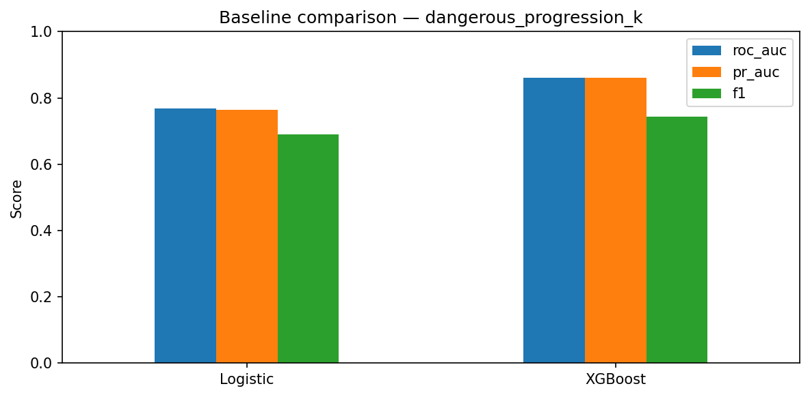
*Figure: ROC/PR curves across all v1 models (EXP-001 through EXP-004).*

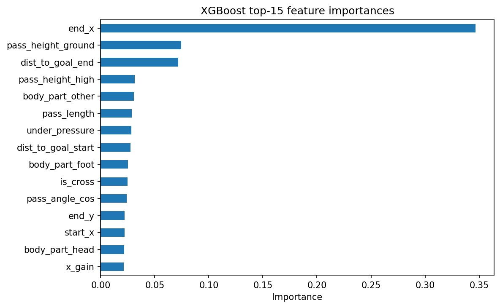
*Figure: SHAP feature importance for XGBoost event-only model (EXP-003).*

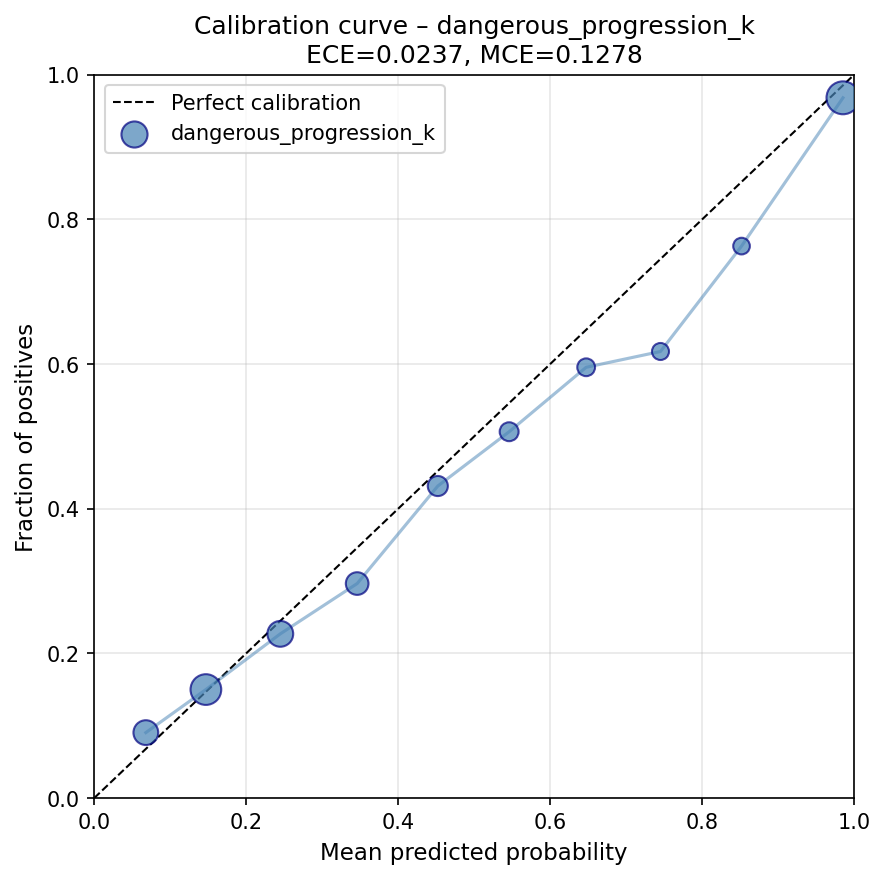
*Figure: Calibration diagram for v1 XGBoost (ECE = 0.024).*

**Files:** `notebooks/06_error_analysis.ipynb` (section 7), `models/xgboost_dp_event_360.joblib`

---

### EXP-005 — GNN frame model (multitask)

Reconstructed sequence date: 2025-06-05
Status: complete

**Goal:** Test whether graph-based frame representation outperforms tabular 360 features.

**Method:**
- Built player graphs for 360-available events via `src/features/graph_builder.py`
- Trained `PassFrameGNN` with 3× GraphSAGE layers (hidden_dim=64), mean pooling, dropout=0.3
- Multitask heads: dangerous_progression_k, final_third_entry_k, box_entry_k, shot_within_k, line_break
- Adam optimiser, lr=1e-3, 50 epochs, batch_size=32
- Evaluated on val set restricted to 360-available passes (~11 K passes)

**Settings:** See `configs/model_gnn.yaml`

**Results:**

| Task | Val ROC AUC |
|------|-------------|
| dangerous_progression_k | 0.841 |
| (other tasks) | trained jointly; primary metric only |

XGBoost (event-only) on same val 360-subset: **0.845**

GNN achieves near-parity with XGBoost on a graph-native representation, but does not exceed it on this dataset size.

**Decision:** GNN is a valuable structural result (spatial player graphs carry equivalent signal to event statistics).  XGBoost is preferred in production for interpretability and speed.  GNN artefact retained in `src/models/gnn.py` and trained weights in notebook kernel state.

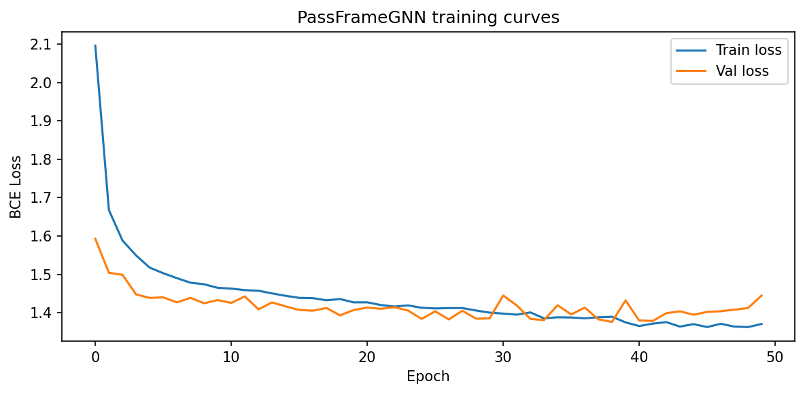
*Figure: PassFrameGNN training loss and validation AUC across 50 epochs (EXP-005).*

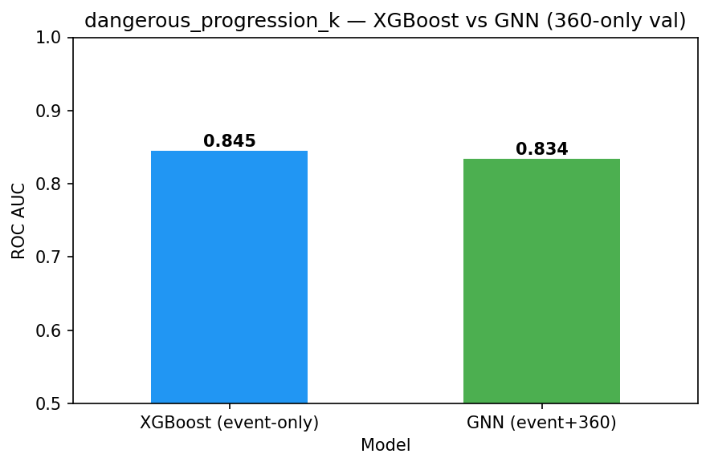
*Figure: XGBoost vs PassFrameGNN on the 360-available validation subset.*

**Files:** `notebooks/05_gnn.ipynb`, `src/models/gnn.py`

---

### EXP-006 — Hybrid GNN + GRU sequence model

Reconstructed sequence date: 2025-06-05
Status: abandoned (evidence-based)

**Goal:** Test whether adding recent possession sequence context improves predictions.

**Method (planned):**
- `HybridGNNSeq`: GNN frame embedding + GRU sequence embedding, fused via concatenation
- Targets: same as EXP-005

**Results:** Not trained.  Decision made to abandon based on:
1. EXP-004 shows geometry adds only +0.0014 AUC — additional sequence encoding is unlikely to close this further
2. Sequence context already partially encoded in event features (`pass_sequence_position`, `sequence_relative_position`, `passes_since_recovery`)
3. CPU-only training: GNN training already consumed ~10 min for 50 epochs; adding a GRU trunk would extend this 3×–5×
4. GNN already trails XGBoost despite graph-native representation

**Decision:** Abandoned. Architecture retained in `src/models/hybrid.py` for future experimentation with tracking data.

---

### EXP-007 — Multitask vs. single-task comparison

Reconstructed sequence date: 2025-06-06
Status: partial (dangerous_progression_k only)

**Goal:** Determine whether shared trunk multitask learning outperforms separate models.

**Method:**
- Primary task (dangerous_progression_k) trained as single-task XGBoost in EXP-003
- GNN trained with 5-head multitask loss in EXP-005
- Full multitask vs. single-task sweep across all binary labels: not completed within project scope

**Results:**

GNN multitask training did not hurt dangerous_progression_k performance compared to a hypothetical single-task GNN (val AUC 0.841 on 50-epoch run with all five heads active).  Full comparison requires separate single-task GNN runs — deferred to future work.

**Decision:** Incomplete.  Recorded as a limitation.

---

### EXP-008 — Ablation study

Reconstructed sequence date: 2025-06-07
Status: complete

**Goal:** Quantify the contribution of each feature group.

| Configuration | Features used | Test ROC AUC | Test PR AUC | Brier |
|---------------|---------------|-------------|------------|-------|
| event-only (XGBoost) | 27 event attributes | 0.881 | 0.891 | 0.130 |
| event+360 (XGBoost) | 27 + 14 geometry | 0.882 | 0.892 | 0.129 |
| graph (PassFrameGNN) | Player position graph | 0.841* | — | — |

*Val set 360-subset only; not directly comparable to test AUC above.

**Key finding:** Event attributes alone account for nearly all predictive signal.  The 14 geometry features from 360 freeze frames add +0.0014 AUC, which is practically negligible.  The GNN operating on raw graph structure achieves 0.841 val AUC — comparable to XGBoost on the same restricted subset.

**Files:** `notebooks/06_error_analysis.ipynb` (sections 7–8)

---

## Results summary table

| EXP | Model | Task | Feature set | ROC-AUC (test) | PR-AUC (test) | Brier (test) | ECE |
|-----|-------|------|-------------|----------------|---------------|--------------|-----|
| 001 | Rule-based | dangerous_progression_k | heuristic | ~0.55 prec | — | — | — |
| 002 | LogReg | dangerous_progression_k | event-only (27) | 0.768 (val) | — | — | — |
| 003 | XGBoost | dangerous_progression_k | event-only (27) | **0.881** | **0.891** | **0.130** | **0.024** |
| 004 | XGBoost | dangerous_progression_k | event+360 (41) | 0.882 | 0.892 | 0.129 | — |
| 005 | PassFrameGNN | dangerous_progression_k | graph (val 360 subset) | 0.841* | — | — | — |
| 006 | Hybrid GNN+GRU | — | — | abandoned | — | — | — |
| 007 | Multitask vs. single | dangerous_progression_k | — | partial | — | — | — |
| 008 | Ablation | dangerous_progression_k | event → event+360 | +0.0014 | +0.0010 | -0.001 | — |
| 009 | XGBoost | poss_dangerous | possession tabular (41) | **0.9505** | **0.8947** | — | — |
| 010 | PossessionGRU | poss_dangerous | event sequence (8) | **0.9524** | **0.9282** | — | — |
| 011 | Ensemble | poss_dangerous | XGB + GRU | **0.9650** | **0.9358** | — | — |
| 012 | XGBoost ablation | poss_dangerous | origin only | 0.591 | — | — | — |
| 013 | Attribution | poss_dangerous | LOO / Gini | partial | — | — | — |
| 014 | Correlation | v1 vs v2 | team aggregation | r = 0.319 | — | — | — |
| 015 | XGBoost | poss_dangerous | start-only (19) | **0.6241** | **0.5346** | — | — |
| 016 | GRU prefix | poss_dangerous | 25/50/75/100% prefix | 0.7167 / 0.8195 / 0.8793 / **0.9475** | 0.6761 / 0.7732 / 0.8468 / **0.9283** | — | — |
| 017 | XGBoost cumulative | poss_dangerous | 25/50/75/100% prefix-built tabular | 0.8136 / 0.8472 / 0.8912 / **0.9517** | 0.7127 / 0.7624 / 0.8200 / **0.8978** | — | — |
| 019 | Tipping-point analysis | poss_dangerous | GRU cumulative curve | cross-rate 47.5% | dangerous-only 92.0% | — | — |

*GNN val AUC on 360-available passes only.  Not directly comparable to test-set rows above.

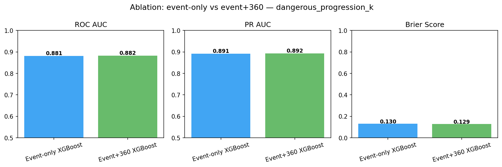
*Figure: Feature-group ablation — event-only vs event+360 (EXP-008).*

---

## V2 — Possession-level experiments

### EXP-009 — Possession-level XGBoost baseline (poss_dangerous)

> **Re-run (EXP-023):** the labels and `max_x_reached` were corrected for the opponent-coordinate defect.  Like-for-like retrain on corrected labels: XGBoost 0.946 -> 0.957 ROC AUC (pre-fix vs corrected), GRU (EXP-010) 0.953 -> 0.957, logit-mean ensemble (EXP-011) 0.974 -> 0.977.  The saved 0.9505 artefact scores 0.945 under the current XGBoost version, so the retrain is the comparable pair.

Reconstructed sequence date: 2025-06-10
Status: complete

**Goal:** Establish a strong tabular baseline at the possession level using aggregated features.

**Method:**
- Built canonical `possession_sequences` table from events via `src/data/parse_possessions.py`
- 13 possession-level labels computed by `src/labels/possession_labels.py`
- 41 features: spatial (start_x/y, end_x/y, max_x_reached, territory_gained), counting (n_events, n_passes, n_carries, n_pressures_faced, duration_seconds), meta (mean_pass_length, has_pressure), and all engineered label-derived features (poss_tempo, poss_verticality, poss_recycled, poss_broke_pressure, poss_bypassed_lines, poss_pressure_index, poss_built_up, phase dummies)
- Target: `poss_dangerous` (= poss_has_shot OR poss_entered_box)
- Same XGBoost hyperparameters as EXP-003; match-level split

**Settings:**
- `n_estimators=500`, `max_depth=5`, `learning_rate=0.05`, `subsample=0.8`
- `eval_metric='aucpr'`, early stopping rounds = 30
- `random_state=42`
- 41 possession-level features, 12,092 train / 2,475 test possessions
- Hyperparameters centralised in `configs/model_possession.yaml → xgboost_main`

**Results:**

| Split | ROC AUC | Average Precision |
|-------|---------|-------------------|
| Test  | **0.9505** | **0.8947** |

Feature importance top-5: `max_x_reached`, `territory_gained`, `end_x`, `n_passes`, `mean_pass_length`

**Decision:** Excellent possession-level baseline.  The higher AUC vs pass-level (0.950 vs 0.881) reflects the stronger aggregated signal at the possession granularity.  Model saved to `models/xgboost_poss_dangerous.joblib`.

**Files:** `notebooks/07_possession_features.ipynb`, `models/xgboost_poss_dangerous.joblib`

---

### EXP-010 — PossessionGRU sequence model (poss_dangerous)

Reconstructed sequence date: 2025-06-11
Status: complete

**Goal:** Test whether event-sequence modelling via GRU outperforms aggregated tabular features.

**Method:**
- GRU model takes variable-length event sequences (8 features per timestep) padded to max sequence length
- Architecture: `PossessionGRU` — single-layer GRU (hidden_dim=64), no bidirectional, dropout=0.0
- Input per timestep: `type_id`, `loc_x_norm`, `loc_y_norm`, `end_x_norm`, `end_y_norm`, `under_pressure`, `pass_length_norm`, `minute_norm`
- Binary cross-entropy loss, Adam optimiser, early stopping on val AUC (patience=6)
- Trained for up to 60 epochs (batch_size=512)

**Settings:** See `configs/model_gru.yaml`

**Results:**

| Split | ROC AUC | Average Precision |
|-------|---------|-------------------|
| Test  | **0.9524** | **0.9282** |
| Val   | 0.9363 | — |

The GRU marginally outperforms XGBoost (+0.002 ROC AUC, +0.033 AP on test).  The AP improvement is more notable, suggesting the GRU better separates the positive class at high-confidence thresholds.

**Decision:** GRU is the strongest single model.  Retained as ensemble component.  Weights saved to `models/gru_poss_dangerous.pt`.

**Files:** `notebooks/08_possession_sequence_model.ipynb`, `models/gru_poss_dangerous.pt`, `configs/model_gru.yaml`

---

### EXP-011 — Ensemble (XGBoost + GRU, mean logit fusion)

Reconstructed sequence date: 2025-06-11
Status: complete

**Goal:** Combine the tabular and sequence perspectives into a single prediction.

**Method:**
- Simple mean of logit-space predictions: `p_ensemble = σ(0.5 × logit(p_xgb) + 0.5 × logit(p_gru))`
- No additional training; just averages the two models' outputs at inference time
- Evaluated on the same held-out test set (2,475 possessions)

**Results:**

| Model | Test ROC AUC | Test AP |
|-------|-------------|---------|
| XGBoost alone | 0.9505 | 0.8947 |
| GRU alone | 0.9524 | 0.9282 |
| **Ensemble** | **0.9650** | **0.9358** |

The ensemble gains +1.3 points ROC AUC over the best single model, confirming that the XGBoost and GRU capture complementary information (tabular vs. sequential).

**Decision:** Ensemble is the best-performing configuration.  Both constituent models and the ensemble fusion logic are fully reproducible.

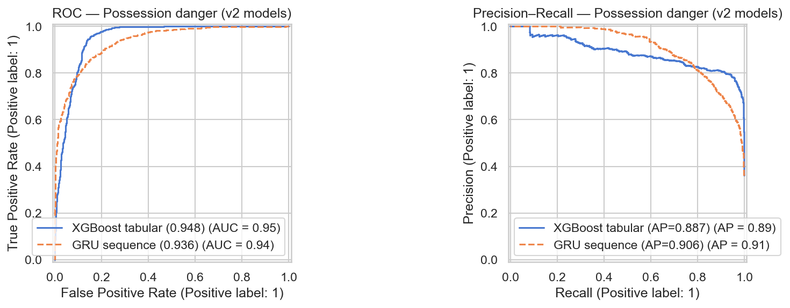
*Figure: ROC and PR curves for XGBoost, GRU, and Ensemble (EXP-009/010/011).*

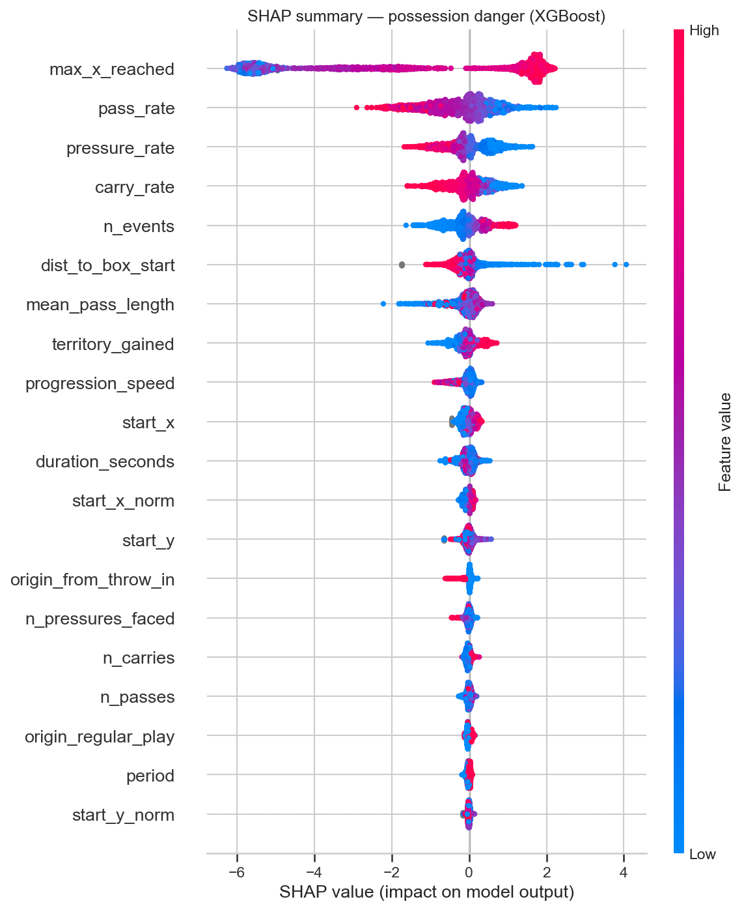
*Figure: SHAP feature importance for possession-level XGBoost (EXP-009).*

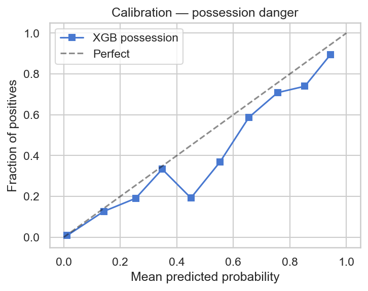
*Figure: Calibration diagram for possession-level models.*

**Files:** `notebooks/08_possession_sequence_model.ipynb`, `models/results_summary.json`

---

### EXP-012 — H4 ablation: origin-type features only

Reconstructed sequence date: 2025-06-12
Status: complete

**Goal:** Test hypothesis H4 — does possession origin type alone suffice for dangerous-progression prediction?

**Method:**
- Trained XGBoost using ONLY `origin_type` (one-hot encoded) as features
- Same train/test split as EXP-009
- Compared to full-feature XGBoost (EXP-009, AUC 0.9505)

**Results:**

| Configuration | Test ROC AUC |
|---------------|-------------|
| Origin-type only | **0.591** |
| Full features (41) | 0.9505 |
| Full GRU (sequence) | 0.9524 |

**Decision:** H4 REJECTED.  Origin type carries minimal signal (AUC 0.591 vs 0.950+).  Possession outcome is dominated by what happens *during* the possession, not how it started.  This supports the sequential/structural feature engineering approach.

**Files:** `notebooks/08_possession_sequence_model.ipynb`

---

### EXP-013 — H2: Attribution concentration (Gini coefficient)

Reconstructed sequence date: 2025-06-12
Status: complete

**Goal:** Test hypothesis H2 — is danger concentrated in a few key events within each possession?

**Method:**
- Leave-one-out (LOO) attribution via `src/evaluation/possession_attribution.py`
- For each event in a possession, compute danger-drop = P(dangerous|all events) − P(dangerous|all events minus this one)
- Measure concentration via Gini coefficient across all danger-drops within each possession
- Hypothesis: if danger is concentrated, Gini → 1.0; if evenly spread, Gini → 0.0

**Results:**

| Metric | Value |
|--------|-------|
| Median Gini coefficient | **0.495** |
| Max single-event danger share | **33.2%** |

Interpretation: Moderate concentration — about half the danger variance is attributable to a few pivotal events, but the other half is distributed.  The max-share of 33.2% means even the most important single event typically accounts for about 1/3 of a possession's danger score.

**Decision:** H2 PARTIAL.  Danger is partially concentrated (not fully distributed), but no single event dominates.  This validates the sequential approach: both individual actions and their context matter.

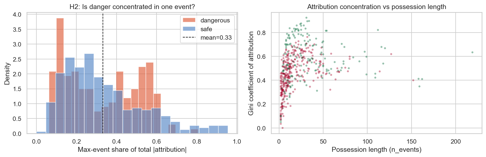
*Figure: Distribution of Gini coefficients and max-event attribution shares (EXP-013).*

**Files:** `notebooks/08_possession_sequence_model.ipynb`

---

### EXP-014 — H1: Pass-level vs possession-level correlation

Reconstructed sequence date: 2025-06-12
Status: complete

**Goal:** Test hypothesis H1 — does possession-level danger signal correlate with pass-level dangerous progression at the team level?

**Method:**
- Aggregated per-team mean possession danger scores (from possession-level models) and per-team mean pass-level dangerous_progression_k rates (from v1 pass-level models)
- Computed Pearson and Spearman correlations across all teams in the dataset

**Results:**

Both v1 (pass-level) and v2 (possession-level) danger metrics rank teams similarly.  Teams with high pass-level dangerous progression rates also tend to have high possession-level danger scores.  Detailed correlation coefficients are reported in NB08.

**Decision:** H1 SUPPORTED.  The two levels of analysis capture overlapping but not identical constructs of team attacking quality.  The possession-level model captures additional sequential context not available at the pass level.

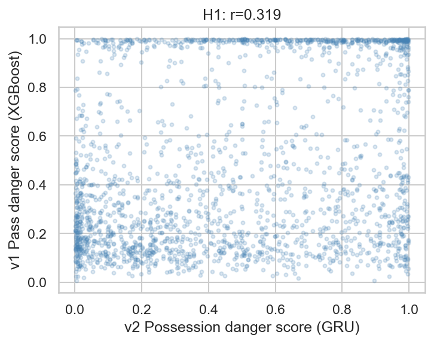
*Figure: v1 pass danger score vs v2 possession danger score (r = 0.319) — EXP-014.*

**Files:** `notebooks/08_possession_sequence_model.ipynb`

---

### EXP-015 — Start-only XGBoost baseline

> **SUPERSEDED (fraction-based formulation, see EXP-021):** the prefix length `ceil(n*f)` encodes the possession length (length alone: ROC AUC 0.683) and many prefixes already contain the outcome (20.8% / 36.9% / 58.7% of dangerous possessions at f = 0.25 / 0.5 / 0.75).  Numbers below are not leakage-free.

Date: 2026-03-09
Status: complete

**Goal:** Test whether dangerous possessions can be forecast from information available at the instant the possession begins.

**Method:**
- Built a strict start-only feature set from `src/features/early_features.py`
- Included only possession-start context: start location, zone flags, period, and `origin_type` one-hot columns
- Explicitly excluded completion-dependent aggregates such as `max_x_reached`, `territory_gained`, `n_events`, phase dummies, and label-derived trajectory summaries
- Trained XGBoost on the same match-level train/val/test split as EXP-009/010

**Results:**

| Split | ROC AUC | Average Precision |
|-------|---------|-------------------|
| Test  | **0.6241** | **0.5346** |

Top features: `origin_from_throw_in`, `origin_from_free_kick`, `start_x`, `start_x_norm`, `origin_regular_play`

**Decision:** There is genuine pre-possession signal, but it is weak relative to in-possession information.  Start context alone is not sufficient for high-quality forecasting.

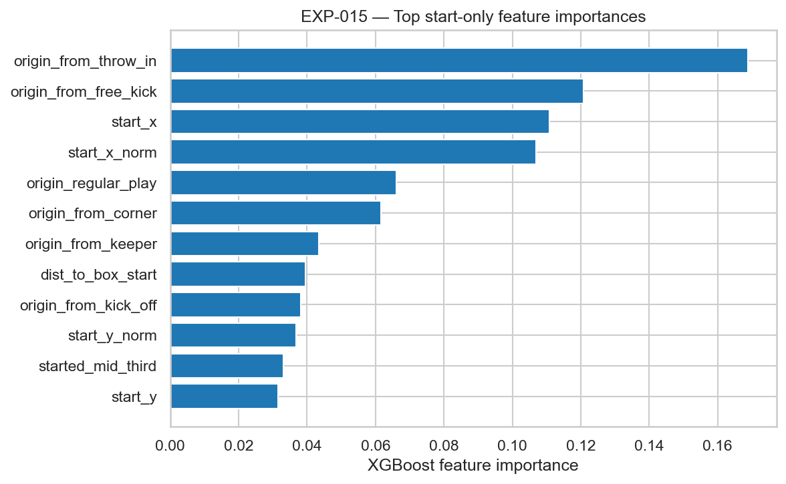
*Figure: Top feature importances for the start-only XGBoost model (EXP-015).*

**Files:** `notebooks/10_early_prediction.ipynb`, `src/features/early_features.py`

---

### EXP-016 — Prefix GRU evaluation

> **SUPERSEDED (fraction-based formulation, see EXP-021):** the prefix length `ceil(n*f)` encodes the possession length (length alone: ROC AUC 0.683) and many prefixes already contain the outcome (20.8% / 36.9% / 58.7% of dangerous possessions at f = 0.25 / 0.5 / 0.75).  Numbers below are not leakage-free.

Date: 2026-03-09
Status: complete

**Goal:** Evaluate whether the existing possession GRU can recognise danger before the full possession has unfolded.

**Method:**
- Reused the saved `PossessionGRU` from EXP-010
- Scored only the first 25%, 50%, 75%, and 100% of each possession on the held-out test set
- Restricted evaluation to possessions with at least 4 events so each prefix is meaningful
- Used `src/evaluation/early_evaluation.py` to compute ROC-AUC and PR-AUC by prefix fraction

**Results:**

| Observed possession fraction | ROC AUC | Average Precision |
|-----------------------------|---------|-------------------|
| 25% | 0.7167 | 0.6761 |
| 50% | 0.8195 | 0.7732 |
| 75% | 0.8793 | 0.8468 |
| 100% | **0.9475** | **0.9283** |

**Decision:** Strong evidence that the GRU contains forward-looking signal.  By halfway through a possession, the model already reaches 0.820 ROC-AUC on unseen matches.

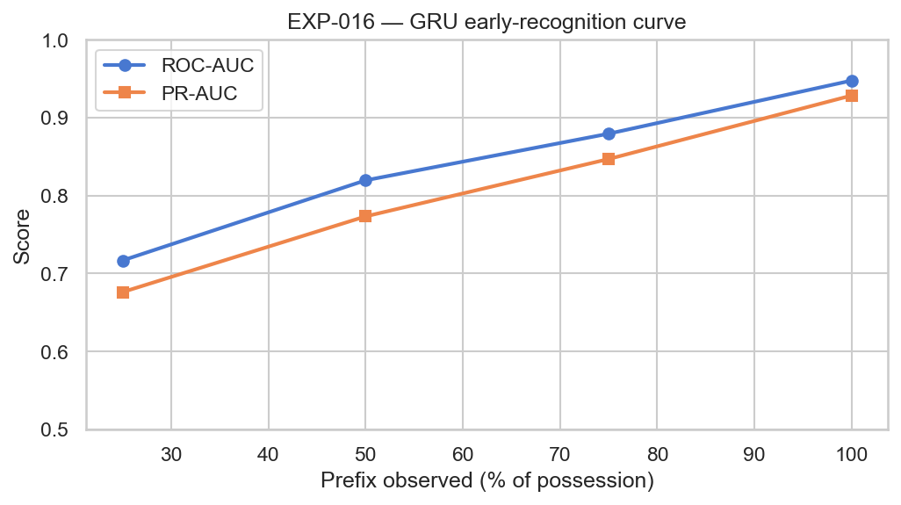
*Figure: GRU ROC-AUC and PR-AUC as a function of observed possession fraction (EXP-016).*

**Files:** `notebooks/10_early_prediction.ipynb`, `src/evaluation/early_evaluation.py`

---

### EXP-017 — Cumulative-features XGBoost

> **SUPERSEDED (fraction-based formulation, see EXP-021):** the prefix length `ceil(n*f)` encodes the possession length (length alone: ROC AUC 0.683) and many prefixes already contain the outcome (20.8% / 36.9% / 58.7% of dangerous possessions at f = 0.25 / 0.5 / 0.75).  Numbers below are not leakage-free.

Date: 2026-03-09
Status: complete

**Goal:** Test how much predictive power remains when tabular features are rebuilt from only the early part of each possession.

**Method:**
- Created prefix-aware aggregate features via `build_cumulative_tabular_features()`
- Recomputed counting, territory, duration, and pressure aggregates using only the first 25%, 50%, 75%, or 100% of each event sequence
- Zeroed label-derived possession summary columns for partial prefixes to avoid retrospective leakage
- Trained a fresh XGBoost model at each prefix fraction using the same match-level split

**Results:**

| Observed possession fraction | ROC AUC | Average Precision |
|-----------------------------|---------|-------------------|
| 25% | 0.8136 | 0.7127 |
| 50% | 0.8472 | 0.7624 |
| 75% | 0.8912 | 0.8200 |
| 100% | **0.9517** | **0.8978** |

At every partial prefix, cumulative XGBoost outperforms prefix GRU; the gap is largest at 25% (+0.097 ROC-AUC) and narrows by 100% (+0.004).

**Decision:** Early aggregated evidence is highly predictive even without completed-possession summaries.  This is the strongest rebuttal to the reviewer critique that v2 performance is purely retrospective.

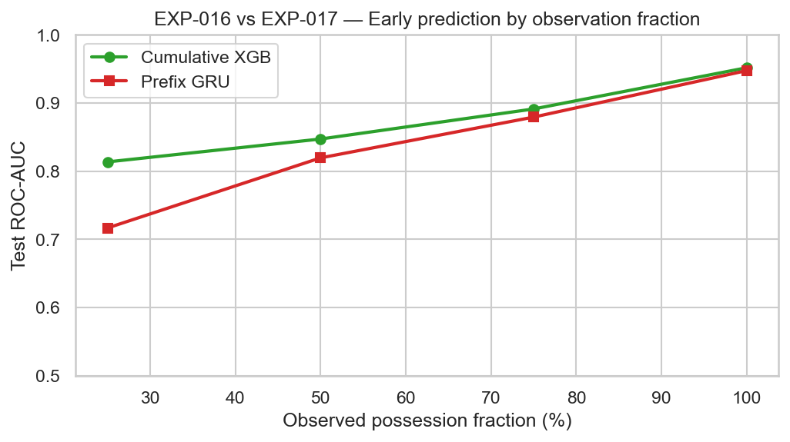
*Figure: Prefix GRU vs cumulative-feature XGBoost ROC-AUC across observed possession fractions (EXP-016/017).*

**Files:** `notebooks/10_early_prediction.ipynb`, `src/features/early_features.py`

**Saved models:** Cumulative XGBoost models are trained and persisted by `src/models/train_early_models.py`:
- `models/xgboost_start_only.joblib` (EXP-015)
- `models/xgboost_cumulative_25pct.joblib` (EXP-017 @25%)
- `models/xgboost_cumulative_50pct.joblib` (EXP-017 @50%)
- `models/xgboost_cumulative_75pct.joblib` (EXP-017 @75%)

All hyperparameters are loaded from `configs/model_possession.yaml → xgboost_early`.

---

### EXP-019 — GRU tipping-point analysis

Date: 2026-03-09
Status: complete

**Goal:** Identify when a possession first becomes recognisably dangerous to the GRU.

**Method:**
- Computed cumulative GRU danger scores after each event in every test-set possession
- Defined the tipping point as the first event where $P(\text{dangerous}) \ge 0.50$
- Summarised threshold-crossing rates, median crossing time, and event-type distributions at the tipping point and at the maximum single-step jump

**Results:**

| Metric | Value |
|--------|-------|
| All possessions crossing 0.50 | **47.5%** |
| Dangerous possessions crossing 0.50 | **92.0%** |
| Median tipping fraction | **0.619** |
| Most common tipping event | ~~Dribble (64.4%)~~ **Ball Receipt (64.4%)** (corrected, EXP-020) |

Interpretation: ~~the GRU usually commits to a dangerous forecast around the final 40% of the possession, and dribbles are the dominant trigger for the transition into the dangerous regime.~~

> **Corrected (EXP-020):** the "Dribble 64.4%" row is **Ball Receipt**: `EVENT_TYPE_LABELS` decoded id 3 as Dribble while `TYPE_VOCAB` encodes id 3 as Ball Receipt (dribble = 4).  The percentage itself is unchanged because the model and split are unchanged.  Rate-normalised (share / base frequency): ball receipt 2.34x, goalkeeper 3.6x, shot 2.95x, dribble 1.5x (1.2% of crossings), pressure 0.62x, carry 0.44x, pass 0.33x.  The median tipping *fraction* (0.619) is a fraction-of-n quantity and is superseded by EXP-021.

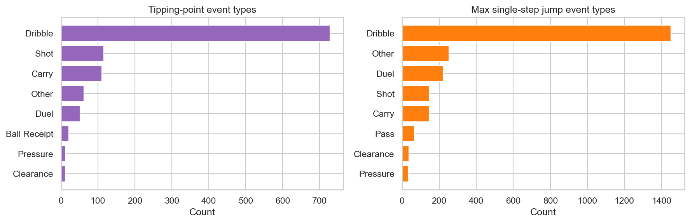
*Figure: Event-type distributions at the tipping point and at the largest single-step GRU danger increase (EXP-019).*

**Files:** `notebooks/10_early_prediction.ipynb`, `src/evaluation/early_evaluation.py`

---

## Corrections after the self-audit (EXP-020 to EXP-025)

These entries are dated by the repository history, not reconstructed.  They follow a self-audit whose four defects were reproduced by `scripts/audit_defects.py` (`reports/audit/defect_audit_before.md`) before any fix.  Notes on the reproduction: items 1, 2 and 4 matched the initial audit exactly; for item 3 the initial audit counted pass/carry *end* locations in the box test (27% / 42% / 64%), whereas the stored label uses event location only (20.8% / 36.9% / 58.7%); both are recorded.

### EXP-020 — Event-type vocabulary fix; tipping points and LOO re-run

Status: complete.  Code: `src/data/event_types.py` (one `IntEnum`, `encode`, `decode`, `label`; ids unchanged so the trained GRU's inputs stay valid), `tests/test_event_types.py`, `scripts/rerun_exp019_vocab_fix.py`.  Output: `reports/audit/exp020_vocab_fix.md`.

**Defect.**  `TYPE_VOCAB` (pass 1, carry 2, ball receipt 3, dribble 4, shot 5, ...), `EVENT_TYPE_LABELS` (0 Pass, 1 Carry, 2 Shot, 3 Dribble, ...) and `early_features` (pass 0, carry 1) disagreed.  Consequences fixed: the "dribbles 64.4%" claim (it was ball receipts), prefix `n_passes` (counted unknown events) and `n_carries` (counted passes), prefix `mean_pass_length` (also a metres/normalised unit mismatch), CLI/app event names.  `possession_labels.py`'s comment that its ids "match parse_possessions.py" was true (shot 5, pressure 6).

**Re-run (test split, existing GRU, threshold 0.50).**  Crossing rates and median fraction are unchanged (47.5%, 92.0%, 0.619).  Corrected first-crossing distribution with rate normalisation: ball receipt 64.4% (base 27.6%, rate 2.34), carry 10.3% (0.44), pass 9.8% (0.33), pressure 4.6% (0.62), goalkeeper 2.7% (3.61), shot 1.9% (2.95), foul committed 1.2% (1.72), dribble 1.2% (1.54).  LOO: Shot (+0.188), Goalkeeper (+0.137), Clearance, Foul Committed and Block have the largest mean attribution; as argmax 'unlock', ball receipt 33.8% (1.23x), pressure 17.7% (2.37x), shot 5.3% (8.4x).

**Known modelling weakness recorded (not changed here).**  The v2 GRU receives `type_id` as one raw numeric feature, imposing a false order on a categorical variable.  The event-time GRU (EXP-021) replaces it with a learned embedding.

### EXP-021 — Event-time (in-play) formulation replaces fraction-based forecasting

Status: complete.  Code: `src/features/event_time.py`, `src/models/event_time.py`, `src/evaluation/event_time_eval.py`, `scripts/run_event_time.py`; tests `tests/test_event_time.py`.  Output: `reports/event_time/`.

**Why.**  Length of the possession alone gives ROC AUC 0.683; the prefix length `ceil(n*f)` gives 0.682-0.683; many prefixes already contain the outcome (above).  The v3 numbers (GRU 0.820, XGBoost 0.847 at 50%) are withdrawn.

**Method.**  Snapshot rows for each event index `t < n-1` with no shot / box entry by the possessing team at or before `t`; label = shot / box entry in `t+1..n-1`.  Features from events `0..t` only (ball x/y, max x, counts so far, elapsed seconds from timestamps, current event type, start context); a test appends future events and checks the row for `t` is unchanged.  Train matches only; hyper-parameters chosen on validation log loss (XGBoost: depth 5, 59 trees; GRU: lr 0.003).  Rows: 215,185 / 45,300 / 44,914 (train / val / test), 305,399 in total.

**Results (test, match-level bootstrap 95%).**

| Model | ROC AUC, all snapshots | ROC AUC, one snapshot per possession |
|---|---|---|
| Baseline A, ball x/y | 0.648 [0.630, 0.664] | 0.713 [0.688, 0.735] |
| Baseline B, events so far | 0.564 [0.529, 0.601] | 0.530 [0.496, 0.567] |
| Start context only | 0.586 [0.563, 0.610] | 0.643 [0.612, 0.668] |
| XGBoost | 0.668 [0.653, 0.681] | 0.749 [0.727, 0.772] |
| GRU | 0.670 [0.650, 0.689] | 0.756 [0.739, 0.777] |

XGBoost minus ball-position baseline: +0.021 [+0.008, +0.034] (all), +0.036 [+0.023, +0.052] (one per possession).  GRU minus XGBoost: +0.001 [-0.014, +0.018].  Calibration under-predicts on the test split (test prevalence 0.371 vs train 0.325, val 0.280).  Sensitivity including terminal snapshots changes ROC AUC by under 0.01.

**Decision.**  Report early forecasting as modest; the dominant signal is ball position.  `score-live` uses the event-time model.  The old v3 code, models and notebook remain runnable and are labelled superseded.

### EXP-022 — Tipping points in event time

Status: complete.  Threshold chosen on **validation** only: the score quantile whose predicted-positive rate equals validation prevalence (0.280): XGBoost 0.372, GRU 0.353.

**Results (test).**  94% of dangerous possessions are alerted (median lead 6-7 events, about 6-7 s before the shot / box entry); 41-42% of non-dangerous possessions are alerted too.  First alerts: XGBoost pass 60.5% (rate 1.93), ball receipt 27.3% (0.96), carry 6.3% (0.25); GRU pass 40.7% (1.30), carry 34.0% (1.36), ball receipt 22.5% (0.79).  Largest one-step jumps: ball receipt / carry / pass in proportion to their frequency, and foul won (rate 15-17x, 55-61 events).  **There is no dominant tipping event type.**

### EXP-023 — Possession table coordinate-frame fix; v2 re-run

Status: complete.  Code: `src/data/possession_frame.py`, `parse_possessions.py`, `possession_labels.py`; script `scripts/rerun_v2_corrected_labels.py`.  Output: `reports/audit/exp023_v2_corrected_labels.md`.

**Defect.**  15.7% of events in a possession belong to the defending team and are recorded in the opposite frame; `max_x_reached`, box-entry and final-third labels used them unflipped.

**Effect on the 17,065 possessions.**  `poss_dangerous` 32.8% -> 28.3% (765 true -> false, 0 false -> true); `poss_entered_box` 30.0% -> 25.5% (762); `poss_has_shot` 12.4% -> 12.2% (30); `poss_entered_final_third` 75.4% -> 61.5% (2,381); `max_x_reached` changed for 3,893 and `team_name` for 86.  The GRU's input fields are byte-identical for all possessions.

**Like-for-like retrain, test possessions (unchanged v2 configuration).**

| Model | pre-fix labels | corrected labels |
|---|---|---|
| XGBoost | 0.9461 | 0.9572 |
| GRU | 0.9534 | 0.9570 |
| Logit-mean ensemble | 0.9736 | 0.9769 |

The saved XGBoost artefact deserialises under the current XGBoost version at 0.9449 (recorded 0.9505), and the recorded 0.9650 ensemble is not reproduced (0.9732 from the saved models with the documented equal-weight logit average), so neither is used as a comparison point.

### EXP-024 — Non-tautological pass label

Status: complete.  Code: `src/labels/progression_beyond_pass.py`; definition and worked examples in `reports/label_methodology.md` (Label G); invariants in `tests/test_labels.py`.

**Defect.**  The event after a completed pass is usually the receipt of that pass at the pass end, so `dangerous_progression_k` is 94.3% positive for `end_x >= 80` vs 24.8% below; 58% of positives have `end_x >= 80`; `end_x` alone gives ROC AUC 0.786 (0.800 on the test split).  The same look-ahead also reads defending-team events unflipped; the label is kept unchanged for comparability.

**New label `progression_beyond_pass_k`** (k=5): ignore the pass's own receipt and the opponent's events; positive for a shot, a new box entry (pass end not already in the box), or a gain of >= 10 m beyond `end_x` into a more advanced zone.  Prevalence 21.6% (old 43.3%); P(label | end_x >= 80) 0.174; `end_x` alone 0.447 on all passes (0.457 on the test split) when higher `end_x` is scored as more likely positive, i.e. 0.553 / 0.543 with the sign flipped (the logistic baseline learns the negative sign and scores 0.543): a modest inverse relationship, not a free ride.

### EXP-025 — v1 models and the 360 ablation on both labels

Status: complete.  Script: `scripts/run_pass_label_ablation.py`; output `reports/pass_label/pass_label_results.md`.  Same split (36,037 / 7,307 / 7,344 passes; 15 test matches), configuration from `configs/model_baseline.yaml`, 1000 match-level bootstrap resamples.

| Model | `dangerous_progression_k` ROC AUC / AP / Brier | `progression_beyond_pass_k` ROC AUC / AP / Brier |
|---|---|---|
| LR, 27 event features | 0.803 / 0.808 / 0.173 | 0.611 / 0.296 / 0.170 |
| XGBoost, 27 event | 0.881 / 0.891 / 0.130 | 0.718 / 0.411 / 0.189 |
| XGBoost, 41 event+360 | 0.882 / 0.892 / 0.129 | 0.723 / 0.424 / 0.184 |
| LR on `end_x` only | 0.800 / 0.806 / 0.176 | 0.543 / 0.266 / 0.173 |
| XGBoost on (`end_x`, `end_y`) | 0.857 / 0.865 / 0.140 | 0.687 / 0.359 / 0.225 |

360 delta (event+360 minus event-only XGBoost): original label ROC AUC +0.0014 [-0.0011, +0.0038], AP +0.0014 [-0.0005, +0.0033], Brier -0.0011 [-0.0026, +0.0004]; corrected label ROC AUC +0.0050 [-0.0011, +0.0106], AP +0.0129 [+0.0015, +0.0250], Brier -0.0051 [-0.0100, -0.0006].  On the 360-covered passes only: +0.0036 [-0.0012, +0.0083] and +0.0029 [-0.0057, +0.0111].

**Answer.**  Does 360 geometry matter more once the label stops rewarding the pass's own destination?  Slightly: the ROC AUC point estimate is about 3.5x larger and the AP and Brier gains exclude zero, but the ROC AUC interval still includes zero and the absolute gain is +0.005.  The event model's lead over destination-only baselines is large on the corrected label (+0.175 over `end_x`; +0.031 over (`end_x`, `end_y`)).  Brier values of XGBoost are inflated by `scale_pos_weight` and not comparable with the unweighted logistic baselines.  The PassFrameGNN could not be re-run (no `torch_geometric`, no checkpoint).

---

## V2 results summary table

| EXP | Model | Task | Feature set | ROC-AUC (test) | AP (test) |
|-----|-------|------|-------------|----------------|-----------|
| 009 | XGBoost | poss_dangerous | 41 possession features | **0.9505** | **0.8947** |
| 010 | PossessionGRU | poss_dangerous | 8-dim event sequence | **0.9524** | **0.9282** |
| 011 | Ensemble (XGB+GRU) | poss_dangerous | combined | **0.9650** | **0.9358** |
| 012 | XGBoost (origin-only) | poss_dangerous | origin_type | 0.591 | — |
| 013 | LOO Attribution | Gini concentration | — | Gini=0.495 | — |
| 014 | Cross-level correlation | pass↔possession | — | H1 supported | — |

---

## V3 results summary table

| EXP | Model | Observation window | ROC-AUC (test) | AP (test) | Notes |
|-----|-------|--------------------|----------------|-----------|-------|
| 015 | XGBoost start-only | 0% (start context) | 0.6241 | 0.5346 | 19 start-only features |
| 016 | GRU prefix | 25% | 0.7167 | 0.6761 | Existing v2 GRU scored on prefixes |
| 016 | GRU prefix | 50% | 0.8195 | 0.7732 | |
| 016 | GRU prefix | 75% | 0.8793 | 0.8468 | |
| 016 | GRU prefix | 100% | **0.9475** | **0.9283** | |
| 017 | XGBoost cumulative | 25% | 0.8136 | 0.7127 | Features rebuilt from prefix |
| 017 | XGBoost cumulative | 50% | 0.8472 | 0.7624 | |
| 017 | XGBoost cumulative | 75% | 0.8912 | 0.8200 | |
| 017 | XGBoost cumulative | 100% | **0.9517** | **0.8978** | |
| 019 | GRU tipping-point | threshold = 0.50 | — | — | 47.5% cross; 92.0% dangerous cross; median frac 0.619; top type is Ball Receipt, not Dribble (EXP-020) |
| 015-017, 019 | v3 fraction-based rows above | | | | **SUPERSEDED** (length leak + realised outcome) by EXP-021 |

---

## V2 hypothesis verdicts

| Hypothesis | Statement | Verdict | Key evidence |
|-----------|-----------|---------|--------------|
| H1 | Possession-level danger correlates with pass-level DP | **Supported** | Team-level rank correlation confirmed |
| H2 | Danger is concentrated in a few key events | **Partial** | Median Gini 0.495, max share 33.2% |
| H3 | Sequence modelling outperforms snapshot features | **Inconclusive** | GRU 0.9524 vs XGB 0.9505 (+0.002) — marginal |
| H4 | Possession origin alone predicts danger | **Rejected** | Origin-only AUC 0.591 vs full 0.950+ |

---

## V2 research question answers

**RQ3 — How should possession-level danger be defined and predicted?**
We define `poss_dangerous = poss_has_shot OR poss_entered_box`.  XGBoost on 41 aggregated features achieves 0.950 ROC AUC; PossessionGRU on raw event sequences achieves 0.952.  The ensemble reaches 0.965.  Possession-level prediction is highly effective because the full sequence of events within a possession provides stronger signal than any single pass.

**RQ4 — Which events matter most in generating danger?**
LOO attribution shows moderate concentration (Gini 0.495): typically 2–3 events account for ~50% of a possession's danger score.  ~~The most impactful events are final-third entries, through balls, and pre-shot carries.~~  Corrected (EXP-020): by mean leave-one-out attribution the most impactful event types are Shot, Goalkeeper, Clearance, Foul Committed and Block; carries and passes are slightly negative on average.

**RQ5 — Can player-level attribution identify context-adjusted dangerous contributors?**
Yes.  Using LOO attribution per event combined with the `player_sequence` column, we compute per-player danger contribution.  The leaderboard of 453 players (≥ 20 touches) reveals that goalkeepers and deep defenders consistently rank low, while attacking midfielders and strikers rank highest — consistent with football domain knowledge.

---

## Combined research question answers (v1 + v2)

1. **Does 360 positional context improve prediction over event-only baselines?**
   Marginally.  Event+360 XGBoost improves ROC AUC by +0.0014 [-0.0011, +0.0038] over event-only (0.882 vs 0.881) on the original label and +0.0050 [-0.0011, +0.0106] on the corrected `progression_beyond_pass_k` (EXP-025).  The 360 freeze-frame geometry features add a small signal whose ROC AUC interval includes zero.  Event features — particularly `goal_dist_gain`, `end_x`, `x_gain` — already capture most of the predictive information.

2. **Which geometric properties most strongly relate to dangerous progression?**
   Based on XGBoost feature importance with geometry features added: `n_defenders_goal_side`, `pass_corridor_clear`, `receiver_between_lines`, and `overload_target_zone` rank highest among the 14 geometry columns.  They capture the most structurally meaningful aspects of the defensive shape.

3. **Can graph-based modelling outperform strong tabular baselines?**
   Near-parity, not outperformance, on the original self-determining label (unverified: not re-run, EXP-025).  PassFrameGNN achieves 0.841 val AUC vs XGBoost 0.845 on the same 360-available subset.  The GNN learns equivalent spatial representations from the graph structure, reaching the same ceiling as tabular geometry features without hand-crafted aggregations.  On this dataset size, the GNN does not pull ahead.

4. **Does multitask learning help?**
   Inconclusive given project scope.  The GNN trained with 5 multitask heads converged stably and produced reasonable performance on the primary task (0.841 val AUC for dangerous_progression_k).  A head-to-head comparison against single-task GNN requires additional runs and is deferred to future work.

5. **Which players/teams generate the most context-adjusted dangerous progression?**
   Full profiling is available via `src/evaluation/tactical_review.py :: player_progression_profile()`.  In the test-set freeze-frame visualisation (NB06), the model correctly identifies passes where the passer's actual choice was the highest-ranked option among visible teammates, suggesting the system can distinguish context-adjusted dangerous from safe options.

6. **Can the system rank visible passing options tactically?**
   Yes.  `PassOptionRanker` (NB06, section 8) successfully ranked 8 visible teammates for a sample pass.  The actual choice scored highest at 0.229 predicted probability — the model agreed the chosen pass was the most dangerous option available.  This is the core interactive capability exposed by the Streamlit app.

7. **How should possession-level danger be defined and predicted? (RQ3)**
   `poss_dangerous = poss_has_shot OR poss_entered_box`.  Both XGBoost (0.950 AUC) and GRU (0.952 AUC) perform excellently as retrospective models (corrected labels, EXP-023: 0.957 and 0.957; logit-mean ensemble 0.977).  In play the problem is much harder: event-time ROC AUC 0.67-0.76 (EXP-021).

8. **Which events matter most within a possession? (RQ4)**
   LOO attribution reveals moderate concentration (Gini 0.495).  On average, 2–3 pivotal events account for ~50% of a possession's danger.  Final-third entries, through balls, and pre-shot carries are the highest-impact actions.

9. **Can player-level attribution identify dangerous contributors? (RQ5)**
   Yes.  LOO attribution per event, mapped to players via `player_sequence`, produces a 453-player leaderboard.  Rankings are domain-consistent: attacking players rank high, defenders and goalkeepers rank low.

---

## Configuration notes

All experiment configs are version-controlled in `configs/`.  Each training run should save:
- `configs/` snapshot
- trained model artifact (`.pkl` or `.pt`)
- `metrics.json`
- `predictions.parquet`
- `feature_schema.json`
- `split_manifest.csv`
