# Final Report — Frame2Threat

**Breaking the Block: Predicting and Explaining Dangerous Progression from StatsBomb Event Data and 360 Freeze Frames**

---

> ## Corrections (October 2026): read this first
>
> A self-audit found four defects.  Each was reproduced (`reports/audit/defect_audit_before.md`), fixed, and every affected result re-run on the **unchanged** match-level split.  Superseded numbers are kept below, marked *superseded*, with the reason and the corrected figure beside them.  Corrected-state audit: `reports/audit/defect_audit_after.md`.
>
> | Claim | Old | Corrected | Status |
> |---|---|---|---|
> | Dribbles trigger 64.4% of tipping points | Dribble 64.4% | The id was **Ball Receipt** (id 3 decoded as "Dribble"); 64.4% is the ball-receipt share, a rate of 2.3x its base frequency; dribbles are 1.2% | **Corrected** |
> | v3 early forecasting at 50% of events | GRU 0.820, XGBoost 0.847 | In-play (event-time) ROC AUC 0.664-0.665 over all snapshots; 0.736-0.739 with one snapshot per possession (20-draw mean 0.729-0.744); ball position alone 0.642 / 0.695.  First event-time version (0.668-0.670 / 0.749-0.756) superseded by the same-moment-leak fix | **Withdrawn / replaced** |
> | 360 lift at pass level | +0.0014 ROC AUC ("statistically positive") | +0.0021 [-0.0010, +0.0055] on the original label; +0.0015 [-0.0036, +0.0070] on the corrected label (first correction said +0.0050; superseded, it used the broken `possession_length`) | **Holds (marginal); "statistically positive" withdrawn** |
> | Pass-level headline | 0.881 | 0.881 on a label that `end_x` alone predicts at 0.800; 0.728 on `progression_beyond_pass_k` (`end_x` alone 0.543; first correction said 0.718, before the `possession_length` fix) | **Corrected** |
> | Possession retrospective | XGB 0.9505, GRU 0.9524, ensemble 0.9650 | Like-for-like retrain on corrected labels: XGB 0.957, GRU 0.957, logit-mean ensemble 0.977 | **Holds** |
> | GNN vs tabular near-parity | 0.841 vs 0.845 (360 subset; original label only, superseded) | Retrained on the corrected label (graph-only, EXP-032): GNN 0.595 [0.578, 0.606] vs XGBoost event+360 0.715 [0.697, 0.734] on the identical 360 test subset; difference -0.1209 [-0.1379, -0.1033] | **Withdrawn / replaced: the GNN does not beat XGBoost** |
>
> The four defects: (1) `parse_possessions.py`, `possession_attribution.py` and `early_features.py` each defined a different event-type mapping (now one enum, `src/data/event_types.py`); (2) "first f% of events" needs the possession length, which alone gives AUC 0.683, and 21-59% of dangerous prefixes already contained the outcome; (3) the defending team's events were used in the wrong coordinate frame, so 765 of 5,589 `poss_dangerous` positives (13.7%) were spurious; (4) the pass label counted the receipt of the pass itself.
>
> **Second self-audit round (October 2026).**  Five further items, each fixed and re-run (`reports/audit/`, EXP-026 to EXP-028): (a) *same-moment leak*: `max_x_so_far` and the GRU's end-x/end-y inputs contained the end of the current pass, which was the box entry the next event would record (1.3% of snapshots, label rate 80.4% vs 31.9%); a possessing-team pass ending in the box is now the danger event, and event-time ROC AUC fell by 0.003-0.006 (all snapshots) and 0.013-0.017 (one per possession); (b) *`possession_length`* in the v1 pass features mixed matches (mean 145 vs a true 6.6, correlation 0.06) and is fixed; the 360 delta on the corrected label becomes +0.0015 [-0.0036, +0.0070], not +0.0050; (c) *shot xG and goals were never parsed*: `poss_xg_generated`, `poss_has_goal` and tier 4 were constant, and now total 295 xG and 305 goal possessions (2.83 goals per match excluding shootouts); no v2 model used them; (d) *recycling*: the headline 42% vs 23% compared possessions averaging 31 vs 11.5 events and came from the pre-fix table; stratified by length, recycled possessions are *less* dangerous in every bin up to 40 events (length-adjusted -2.6 pp); (e) *data description*: 99 matches (64 World Cup 2022 with 360, 35 La Liga 2020/21 without), no Premier League, 360 on 52.3% of passes (not ~65% / ~33,000).  `poss_dangerous` and the other possession labels were **not** changed by (a): the event-time danger definition now disagrees with the stored label on 925 possessions (passes ending in the box with no receipt in the box; all 925 are incomplete or out-of-play passes, i.e. failed deliveries).

---

## 1. Introduction

Modern football analytics increasingly asks not just *what happened* but *why it was dangerous*.  A pass that breaks a defensive line — reaching a player behind the opponent's mid-block — is categorically different from a safe lateral recirculation, even if both events appear similar in event-log data.

This project, **Frame2Threat**, builds a reproducible football analytics system that combines StatsBomb event data with the spatial context of 360 freeze frames to predict and explain when a passage of play produces dangerous progression.  The core insight is that the geometry of the defensive structure at the moment of the pass — who is where, which lanes are open, where defenders are positioned relative to the receiver — contains signal beyond what the event attributes alone can provide.

The system operates at two complementary granularities:

1. **Pass level (v1):** For each individual open-play pass, predict whether it leads to dangerous outcomes within the next 5 events of the same possession.  Uses event attributes, 360 geometry features, and graph neural networks on player-position graphs.

2. **Possession level (v2):** For each full possession sequence, predict whether the possession generates danger (shot or box entry).  Uses aggregated tabular features, GRU sequence models on the event stream, and leave-one-out attribution to identify pivotal events and player contributions.

The system is designed as *event-conditioned positional intelligence*: predictions are made conditioned on the observed spatial layout at the moment of decision, supporting tactical analysis, player evaluation, and scouting applications.

---

## 2. Research Questions

The project addresses six research questions spanning two analysis levels:

### Pass level (v1)
| # | Question |
|---|----------|
| RQ1 | Does 360 positional context improve dangerous-progression prediction over event-only baselines? |
| RQ2 | Which geometric properties of the freeze frame most strongly relate to dangerous progression? |

### Possession level (v2)
| # | Question |
|---|----------|
| RQ3 | How should possession-level danger be defined and predicted? |
| RQ4 | Which events within a possession contribute most to generating danger? |
| RQ5 | Can player-level attribution from sequential models identify context-adjusted dangerous contributors? |

### Cross-cutting
| # | Question |
|---|----------|
| RQ6 | Can graph-based modelling (GNN on freeze frames) outperform strong tabular baselines? |

---

## 3. Data Description

### 3.1 Source

All data is from the **StatsBomb Open Data** repository, accessed via the `statsbombpy` library.  The processed data is **99 matches**:

- **64 FIFA World Cup 2022 matches** (competition_id = 43, season 106), all with 360 freeze frames (30,349 passes, of which 26,515 have a freeze frame);
- **35 La Liga 2020/21 matches involving Barcelona** (competition_id = 11, season 90), with **no** 360 frames (20,339 passes).

There are **no Premier League matches** in the processed data.  `configs/data.yaml` still lists competition 2 because removing it would change the inventory table (an output), not any model input; the file now carries a comment explaining this.  (Self-audit note: the inventory marks the 35 La Liga matches `has_360 = true` although no freeze-frame files exist for them; they are effectively events-only.)

### 3.2 Data reality

- **360 coverage is partial.** Freeze frames exist for 64 of 99 matches (65%) and for **52.3% of passes (26,515 of 50,688)**; the 35 La Liga matches have none, and within the World Cup matches 87% of passes have a frame.  All analyses distinguish events with and without 360 context.
- **Positional snapshots, not trajectories.** The 360 data captures player x/y coordinates at the moment of the event.  Velocities, accelerations, and movement directions are not available.
- **Partial pitch visibility.** Not all 22 players are captured in every frame.  Pass option ranking is restricted to *visible* teammates.
- **Open-play filter.** The v1 modelling table contains only open-play passes; set-piece deliveries are excluded.

### 3.3 Canonical tables

See `reports/data_dictionary.md` for full schema documentation.

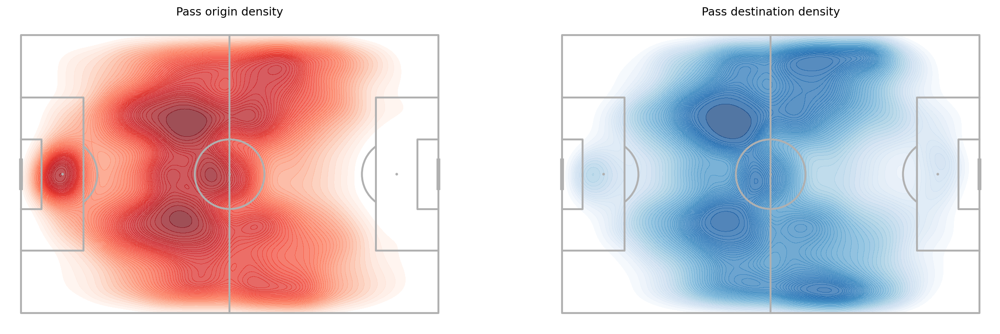
*Figure 3-1: Heatmaps of open-play pass start and end positions across all matches.*

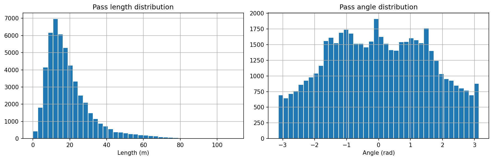
*Figure 3-2: Distributions of pass length, angle, and spatial attributes.*

| Table | Rows (approx.) | Unit | Description |
|-------|---------------|------|-------------|
| `matches` | 99 | Match | One row per match (64 World Cup 2022, 35 La Liga 2020/21) |
| `events` | ~3,000–5,000/match | Event | All event types (passes, shots, carries, pressures, etc.) |
| `lineups` | ~22/match | Player-match | Player roster per team |
| `frames_360` | ~10–20/event | Player-event | Visible player positions per 360 event |
| `pass_instances` | ~500–1,000/match | Pass | Open-play passes with all labels (v1 modelling table) |
| `possession_sequences` | ~170/match (17,065 in total) | Possession | Possession-level aggregation with event sequences and 13 labels (v2 modelling table) |

---

## 4. Problem Formulation

### 4.1 Pass-level prediction (v1)

For each open-play pass, predict six binary labels and one continuous target:

| Label | Type | Definition |
|-------|------|-----------|
| `strict_line_break` | Binary/NaN | ≥ 2 defenders crossed (requires 360) |
| `loose_line_break` | Binary/NaN | ≥ 1 defender crossed (requires 360) |
| `dangerous_progression_k` | Binary | Final-third / box entry / shot within k=5 events |
| `final_third_entry_k` | Binary | Ball reaches x ≥ 80 within k events |
| `box_entry_k` | Binary | Ball enters penalty box within k events |
| `shot_within_k` | Binary | Shot occurs within k events |
| `threat_gain` | Continuous | Zone-value delta (xT proxy) |

**Primary target:** `dangerous_progression_k` (k=5).

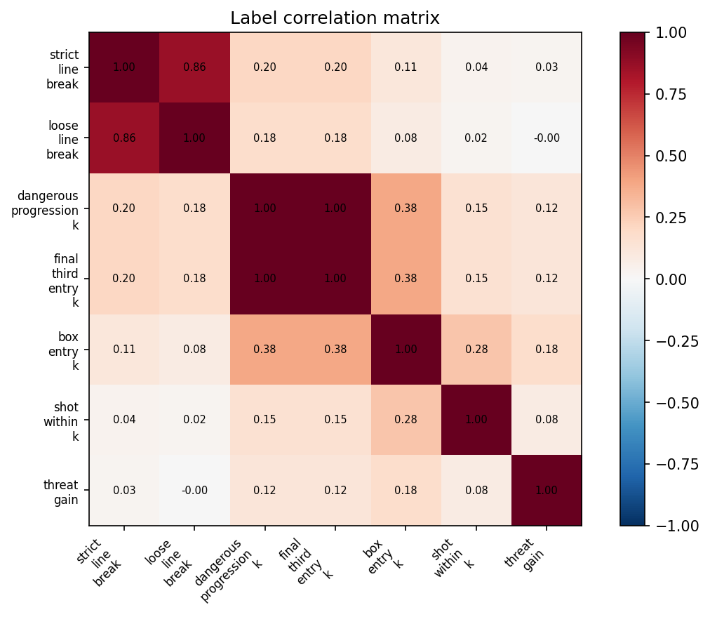
*Figure 4-1: Correlation matrix of v1 pass-level labels — illustrates inter-label relationships.*

### 4.2 Possession-level prediction (v2)

For each possession sequence (≥ 2 events), predict 13 labels across four groups:

| Group | Labels | Primary target |
|-------|--------|---------------|
| A — Core outcome | poss_has_shot, poss_entered_final_third, poss_entered_box, **poss_dangerous** | poss_dangerous |
| B — Rich outcome | poss_xg_generated, poss_has_goal, poss_outcome_tier | — |
| C — Tempo / structural | poss_tempo, poss_verticality, poss_recycled, poss_phase | — |
| D — Defensive disruption | poss_broke_pressure, poss_bypassed_lines | — |

**Primary target:** `poss_dangerous = poss_has_shot OR poss_entered_box`.

### 4.3 Hypotheses (v1)

| H# | Statement |
|----|-----------|
| H1 | 360 freeze-frame geometry adds meaningful predictive value beyond event-only features for dangerous-progression prediction |
| H2 | Non-linear models (XGBoost) significantly outperform linear models (logistic regression) on event features |
| H3 | Graph-based modelling of player positions (GNN) outperforms hand-engineered tabular features on the same 360-available subset |
| H4 | Multitask learning across related pass-level labels improves primary-task (dangerous_progression_k) performance vs single-task training |

### 4.4 Hypotheses (v2)

| H# | Statement |
|----|-----------|
| H1 | Possession-level danger correlates with pass-level dangerous progression at the team level |
| H2 | Danger within a possession is concentrated in a few key events (high Gini coefficient) |
| H3 | Sequence modelling (GRU) outperforms snapshot-based tabular features (XGBoost) |
| H4 | Possession origin type alone is sufficient to predict danger |

### 4.5 Leakage controls

- All downstream labels are computed from future events in the same possession only
- Feature engineering never accesses future events
- Splits are at the match level before any feature computation

---

## 5. Label Construction

See `reports/label_methodology.md` for full operational definitions.

### 5.1 Pass-level labels (v1)

**Line-break labels** use a transparent heuristic based on opponent x-positions in the freeze frame.  The x-axis projection is a deliberate simplification.  Two variants (strict: ≥ 2, loose: ≥ 1 defenders bypassed) bracket the uncertainty.

**Downstream outcome labels** use a k=5 future-event window within the same possession — short enough to attribute causality to the pass, long enough to capture immediate consequences.

**Threat gain** is a zone-value proxy computed empirically from the training set.  It is NOT an expected goals metric but provides interpretable continuous signal.

### 5.2 Possession-level labels (v2)

Computed by `src/labels/possession_labels.py`.  Design principles:
- **Core outcome (Group A):** Binary labels derived from the event sequence within each possession
- **Rich outcome (Group B):** xG and goal information (requires full events table)
- **Tempo / structural (Group C):** Characterise how the possession unfolded (speed, directness, recycling, phase)
- **Defensive disruption (Group D):** Did the team overcome defensive pressure or bypass defensive lines rapidly?

---

## 6. Feature Engineering

### 6.1 Event features (27 features, v1)

Derived purely from pass event attributes:
- **Spatial:** start_x, start_y, end_x, end_y, x_gain, pass_length
- **Kinematic:** pass_angle_rad, pass_angle_sin, pass_angle_cos
- **Distance to goal:** dist_to_goal_start, dist_to_goal_end, goal_dist_gain
- **Flags:** under_pressure, is_forward, is_switch, is_cross, is_through_ball
- **Categorical (one-hot):** body part, pass height, play pattern
- **Context:** minute, period, possession_length, zone_start

### 6.2 360 geometry features (14 features, v1)

From freeze-frame spatial layout: n_defenders_in_corridor, n_defenders_goal_side, nearest_defender_dist (passer/receiver), team/opp width/depth, overload_target_zone, receiver_between_lines, defensive_compactness, pass_corridor_clear.  NaN for non-360 events.

### 6.3 Graph representation (v1)

Player-position graphs for GNN input.  Nodes: visible players with 9 features.  Edges: k-NN spatial (k=5) + same-team connections.

### 6.4 Event sequence encoding (v2)

8-dimensional feature vector per event timestep: type_id (TYPE_VOCAB, 0–13), loc_x_norm, loc_y_norm, end_x_norm, end_y_norm, under_pressure, pass_length_norm, minute_norm.  Variable-length sequences padded at batch time.

### 6.5 Possession-level tabular features (41 features, v2)

Aggregated spatial/temporal/meta features plus derived labels (tempo, verticality, recycled, broke_pressure, bypassed_lines, pressure_index, built_up) and one-hot phase/origin dummies.

---

## 7. Modelling

### 7.1 v1 — Pass-level models

| Model | Features | Purpose |
|-------|----------|---------|
| Rule-based heuristic | x_gain, end_x | Performance floor |
| Logistic regression | Event-only (27) | Linear baseline, isotonic calibration |
| **XGBoost** | **Event-only (27)** | **Primary v1 model** |
| XGBoost | Event+360 (41) | Tests 360 additive value |
| PassFrameGNN | Player graph | 3× GraphSAGE, multitask heads |
| HybridGNNSeq | Graph + GRU | Abandoned (insufficient evidence of value) |

### 7.2 v2 — Possession-level models

| Model | Input | Purpose |
|-------|-------|---------|
| **XGBoost** | **41 tabular features** | **Possession baseline** |
| **PossessionGRU** | **8-dim event sequences** | **Sequential model** |
| **Ensemble** | **XGB logit + GRU logit** | **Best performance (mean fusion)** |

---

## 8. Experimental Design

### 8.1 Split strategy

Match-level 70/15/15 split.  Seed = 42.  Split manifest saved to `data/processed/split_manifest.csv`.

### 8.2 Full experiment registry

| EXP | Model | Task | Features | Goal |
|-----|-------|------|----------|------|
| 001 | Rule-based | dangerous_progression_k | heuristic | Floor |
| 002 | LogReg | dangerous_progression_k | event (27) | Linear baseline |
| 003 | XGBoost | dangerous_progression_k | event (27) | Strong baseline |
| 004 | XGBoost | dangerous_progression_k | event+360 (41) | 360 value |
| 005 | PassFrameGNN | dangerous_progression_k | graph | Graph vs. tabular |
| 006 | Hybrid | — | — | Abandoned |
| 007 | MT vs. ST | dangerous_progression_k | — | Partial |
| 008 | Ablation | dangerous_progression_k | event→event+360 | Feature groups |
| 009 | XGBoost | poss_dangerous | possession (41) | Possession baseline |
| 010 | GRU | poss_dangerous | event sequence | Sequence model |
| 011 | Ensemble | poss_dangerous | XGB+GRU | Combination |
| 012 | XGBoost | poss_dangerous | origin-only | H4 ablation |
| 013 | LOO | Gini concentration | — | H2 test |
| 014 | Correlation | pass↔possession | — | H1 test |
| 015 | XGBoost | poss_dangerous | start-only | Early forecasting baseline |
| 016 | GRU | poss_dangerous | prefix evaluation | Early forecasting curve |
| 017 | XGBoost | poss_dangerous | cumulative prefix features | Prefix tabular benchmark |
| 019 | GRU | tipping-point analysis | cumulative trajectories | Event trigger analysis |

Full details in `reports/experiment_log.md`.

---

## 9. Results

> **Consolidated results table** (from NB08 and NB10; *rows marked superseded are kept for the record*; current numbers are in the corrections box above and in sections 9.2-9.5):
>
> | Model | Unit | Observation | ROC AUC | AP |
> |-------|------|-------------|---------|-----|
> | XGBoost event-only (v1) | pass | single event | 0.881 | 0.891 |
> | XGBoost event+360 (v1) | pass | single event + freeze frame | 0.882 | 0.892 |
> | XGBoost tabular (v2) | possession | full possession, retrospective | 0.948 | 0.887 |
> | GRU sequence (v2) | possession | full sequence, retrospective | 0.936 | 0.906 |
> | Ensemble XGB+GRU (v2) | possession | retrospective upper bound | 0.965 | 0.936 |
> | XGBoost start-only (v3) | possession | 0% observed | 0.624 | 0.535 |
> | ~~GRU prefix (v3)~~ *superseded: length leak, outcome already in prefix* | possession | 50% observed | 0.820 | 0.773 |
> | ~~XGBoost cumulative (v3)~~ *superseded* | possession | 50% observed | 0.847 | 0.762 |
> | GRU event-time (corrected formulation) | possession | in play, all snapshots | 0.664 | 0.572 |
> | XGBoost event-time (corrected formulation) | possession | in play, all snapshots | 0.665 | 0.567 |
> | GRU event-time, one snapshot per possession | possession | in play | 0.739 | 0.581 |
>
> *Note: v1, v2, and v3 are not directly comparable — they operate at different units and observation horizons. v2 full-possession metrics are retrospective upper bounds because they use completed-possession information.*
> *v1 `dangerous_progression_k` positive rate: 43.3% (`progression_beyond_pass_k`: 21.6%) | possession `poss_dangerous` rate: 28.3% after the coordinate-frame fix (32.8% before; the earlier "~37% / ~36%" figures were approximate and are superseded)*

### 9.1 Dataset summary

**v1 — Pass level:**

| Split | Matches | Pass instances | 360-available |
|-------|---------|---------------|---------------|
| Train | 69 | 36,037 | 18,234 |
| Val | 15 | 7,307 | 4,545 |
| Test | 15 | 7,344 | 3,736 |
| **Total** | **99** | **50,688** | **26,515 (52.3%)** |

*Superseded: an earlier version of this table gave ~33,000 360-available passes (about 65%); the correct figures are above (65% is the share of matches, not of passes).*

Label prevalence (k=5): `dangerous_progression_k` 43.3% (test 44.8%); `progression_beyond_pass_k` 21.6% (test 22.4%).  *(Superseded: "~37%".)*

**v2 — Possession level:**

| Split | Possessions |
|-------|-------------|
| Train | 12,092 |
| Test | 2,475 |

Label prevalence (`poss_dangerous`): ~25%.

### 9.2 v1 — Pass-level results

| Model | Features | Split | ROC AUC | PR AUC | Brier | ECE |
|-------|----------|-------|---------|--------|-------|-----|
| Rule-based | spatial | test | ~0.55 prec | — | — | — |
| LogReg + isotonic | event (27) | val | 0.768 | — | — | — |
| **XGBoost** | **event (27)** | **test** | **0.881** | **0.891** | **0.130** | **0.024** |
| XGBoost | event+360 (41) | test | 0.882 | 0.892 | 0.129 | — |
| PassFrameGNN (original label only, superseded) | graph | val (360) | 0.841 | — | — | — |

**Key findings:**
- XGBoost (event-only): 0.881 AUC with excellent calibration (ECE 0.024)
- 360 geometry: +0.001 AUC — practically negligible (*on the self-determining label; +0.0021 [-0.0010, +0.0055] after the `possession_length` fix, and +0.0015 [-0.0036, +0.0070] on the corrected label, see the correction above*)
- GNN: near-parity (0.841) with XGBoost on same 360 subset (*original label only, superseded; unreproducible, the saved output says 0.834; see EXP-032: on the corrected label the graph-only GNN scores 0.595 [0.578, 0.606] vs 0.715 [0.697, 0.734] for XGBoost event+360*)
- Linear→non-linear gap: +9 AUC points (LogReg → XGBoost)

**Top SHAP features:** goal_dist_gain, end_x, x_gain, pass_length, dist_to_goal_end

> **Correction (label defect).**  `dangerous_progression_k` looks ahead k=5 events and the first of them is normally the receipt of the pass itself, recorded at the pass end, so any pass with `end_x >= 80` is positive 94% of the time and `end_x` alone gives ROC AUC 0.786 (0.800 on the test split).  The 0.881 above is therefore *superseded as evidence about event or 360 information*.  Re-run on the same split with the new label `progression_beyond_pass_k` (`reports/label_methodology.md`, Label G; `reports/pass_label/pass_label_results.md`), test set, 15 matches:
>
> | Model | `dangerous_progression_k` ROC AUC / AP | `progression_beyond_pass_k` ROC AUC / AP |
> |---|---|---|
> | Logistic regression, 27 event features | 0.803 / 0.808 | 0.612 / 0.296 |
> | XGBoost, 27 event features | 0.881 / 0.892 | **0.728** [0.713, 0.743] / 0.422 |
> | XGBoost, 41 event+360 features | 0.883 / 0.894 | 0.729 [0.715, 0.745] / 0.426 |
> | `end_x` only (logistic regression) | 0.800 / 0.806 | 0.543 / 0.266 |
> | `(end_x, end_y)` only (XGBoost) | 0.857 / 0.865 | 0.687 / 0.359 |
>
> 360 delta (event+360 minus event-only, 1000 match-level bootstrap resamples): ROC AUC +0.0021 [-0.0010, +0.0055] on the original label and **+0.0015 [-0.0036, +0.0070]** on the corrected one (corrected label: average precision +0.0041 [-0.0053, +0.0134], Brier -0.0038 [-0.0067, -0.0015]).  On passes with 360 only: +0.0030 [-0.0024, +0.0083] (original) and -0.0015 [-0.0106, +0.0069] (corrected).  Answer to "does 360 geometry matter more once the label stops rewarding the destination?": **no**: the ROC AUC and AP gains are about +0.002 / +0.004 with intervals that include zero, and only the Brier improvement excludes it.  (An earlier version of this box said +0.0050, "about 3.5x larger"; that came from the broken `possession_length` feature, which mixed matches, and is superseded; before/after in `reports/pass_label/possession_length_fix_before_after.md`.  The event-only XGBoost on the corrected label also moved from 0.718 to 0.728 with the fix.)  Brier values of the XGBoost models are inflated by `scale_pos_weight` and are not comparable with the unweighted logistic baselines.

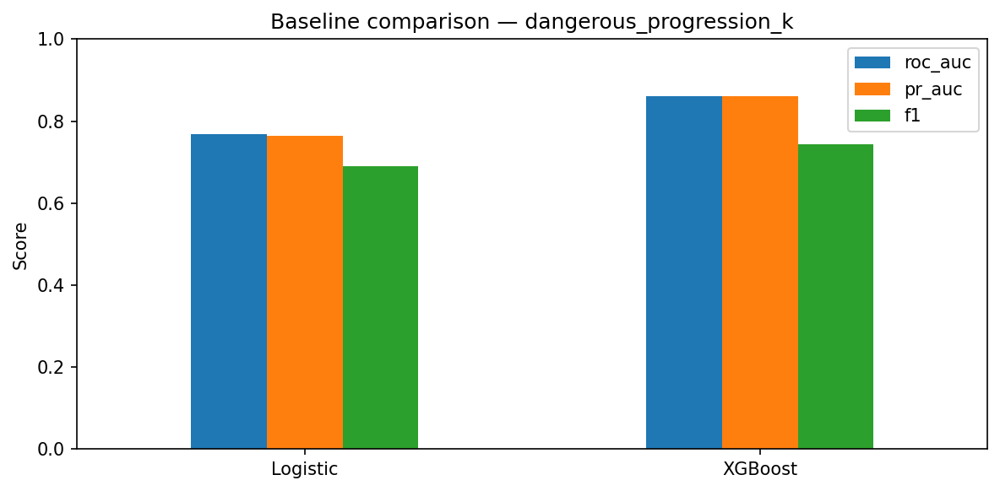
*Figure 9-1: ROC/PR curves across all v1 model variants.*

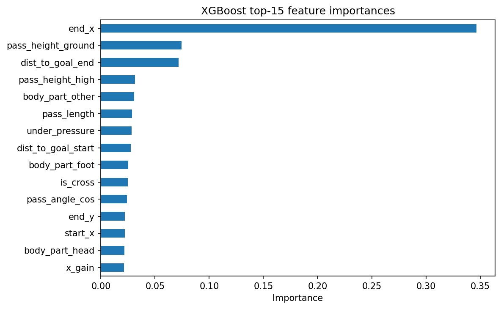
*Figure 9-2: SHAP feature importance for XGBoost event-only model.*

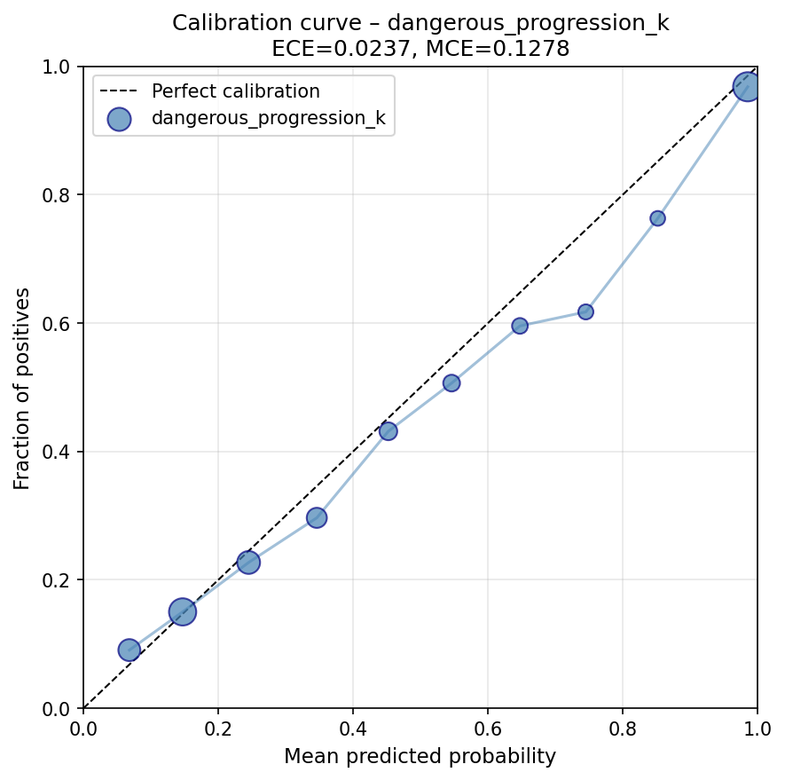
*Figure 9-3: Calibration (reliability) diagram for v1 XGBoost.*

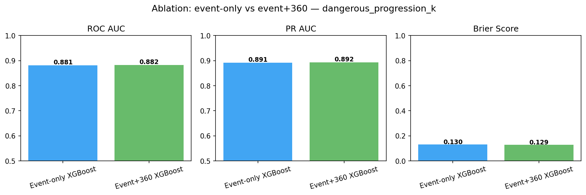
*Figure 9-4: Feature-group ablation — event-only vs event+360 geometry.*

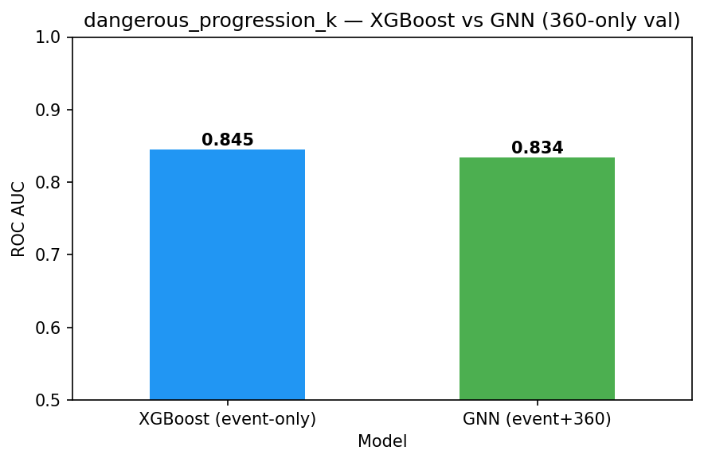
*Figure 9-5: XGBoost vs PassFrameGNN on 360-available subset.*

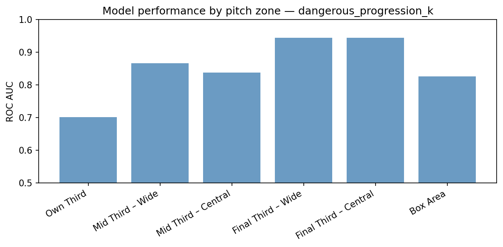
*Figure 9-6: Model performance by pitch zone.*

#### v1 — Hypothesis verdicts

| H# | Statement | Verdict | Key evidence |
|----|-----------|---------|---------------|
| H1 | 360 geometry improves prediction | **Rejected (marginal)** | +0.002 [-0.001, +0.006] on the original label (0.881 → 0.883), +0.0015 [-0.004, +0.007] on the corrected label; small, ROC AUC intervals include zero |
| H2 | Non-linear > linear | **Supported** | +9 AUC points (LogReg 0.768 → XGBoost 0.881) |
| H3 | GNN outperforms tabular | **Not supported** | (EXP-032, corrected label: GNN 0.595 [0.578, 0.606] vs XGBoost event+360 0.715 [0.697, 0.734]; original: GNN 0.841 vs XGBoost 0.845 on same 360 subset, using the self-determining label; not re-run |
| H4 | Multitask > single-task | **Inconclusive** | EXP-007 partial; controlled comparison not completed |

**Detailed v1 hypothesis evidence:**

> **H1** — XGBoost event-only: 0.881 AUC.  XGBoost event+360: 0.882 AUC.  Delta: +0.001.
> The 14 geometry features (defensive corridor counts, compactness, lane openness, etc.) carry a small additive value (the interval for the ROC AUC delta includes zero, so "statistically positive" is withdrawn).  Event features already encode most spatial signal through start/end coordinates and goal_dist_gain.  The 65% coverage restriction further limits deployability.

> **H2** — Logistic regression: 0.768 AUC.  XGBoost: 0.881 AUC.  Delta: +0.113.
> The 9 AUC-point gap demonstrates that non-linear interactions among event features (e.g., pass_length × end_x, angle × under_pressure) are essential.  The strongest features (goal_dist_gain, end_x, x_gain) interact multiplicatively rather than additively.

> **Superseded (EXP-032).**  The H3 evidence below is original label only and could not be reproduced (no checkpoint; the saved output says 0.834).  Retrained on the corrected label as a graph-only model (8 node features, no pass-destination information): On the identical 360 test subset (3,736 passes, 9 World Cup 2022 matches) the graph-only PassFrameGNN scores ROC AUC 0.595 [0.578, 0.606] against 0.715 [0.697, 0.734] for XGBoost event+360; the paired difference is -0.1209 [-0.1379, -0.1033], so the GNN is clearly worse.  It beats the `end_x`-only baseline (0.530 [0.502, 0.551]; paired difference +0.0646 [+0.0501, +0.0845]).  The GNN does not outperform tabular.

> **H3** — PassFrameGNN (3× GraphSAGE, 64 hidden): 0.841 val AUC on 360-subset.  XGBoost on same subset: 0.845 val AUC.
> The GNN achieves near-parity, confirming that spatial player graphs carry equivalent signal to hand-engineered geometry features.  However, the GNN does not exceed the tabular model, likely due to dataset size (~11K 360-available passes) and the effectiveness of the existing tabular feature engineering.

> **H4** — EXP-007 (multitask vs single-task) was only partially completed.  The multitask GNN (EXP-005) trained jointly on 5 labels, but no controlled single-task comparison was run to completion.  Insufficient evidence to confirm or reject.

### 9.3 v2 — Possession-level results

| Model | Input | Test ROC AUC | Test AP |
|-------|-------|-------------|---------|
| XGBoost | 41 tabular features, retrospective | 0.9505 | 0.8947 |
| PossessionGRU | 8-dim full event sequence, retrospective | 0.9524 | 0.9282 |
| Ensemble (XGB+GRU) | retrospective upper bound | 0.9650 | 0.9358 |
| XGBoost (origin-only) | origin_type | 0.591 | — |

> **Correction (coordinate frame).**  The defending team's events were scored in the opposite frame, so 765 `poss_dangerous` labels (13.7% of positives; prevalence 32.8% -> 28.3%) and 2,381 final-third flags were spurious.  A like-for-like retrain with the unchanged v2 configuration (`reports/audit/exp023_v2_corrected_labels.md`) gives, on the same test possessions: XGBoost 0.946 -> **0.957** (pre-fix vs corrected labels), GRU 0.953 -> **0.957**, logit-mean ensemble 0.974 -> **0.977**.  The retrospective numbers hold (they did not benefit from the defect).  (The saved XGBoost artefact loaded under the current XGBoost version scores 0.945 on the original labels rather than the recorded 0.9505, so this retrain is the comparable pair; the recorded 0.9650 ensemble is not reproduced either: the documented equal-weight logit average of the saved models gives 0.973 on the original labels.)

**Key findings:**
- Full-possession retrospective classification dramatically outperforms pass-level prediction (0.950+ vs 0.881), but this is not a leakage-free early-prediction comparison
- GRU marginally outperforms XGBoost (+0.002 AUC, +0.033 AP)
- Ensemble gains +1.3 AUC points over best single model
- Origin type alone is insufficient (0.591 AUC)

Timing caveat: the v2 tabular model includes completion-dependent features such as `max_x_reached` and `territory_gained`, while `poss_dangerous` includes box entry. These metrics should be read as retrospective upper bounds unless the model is rebuilt with a strict event-time cutoff.

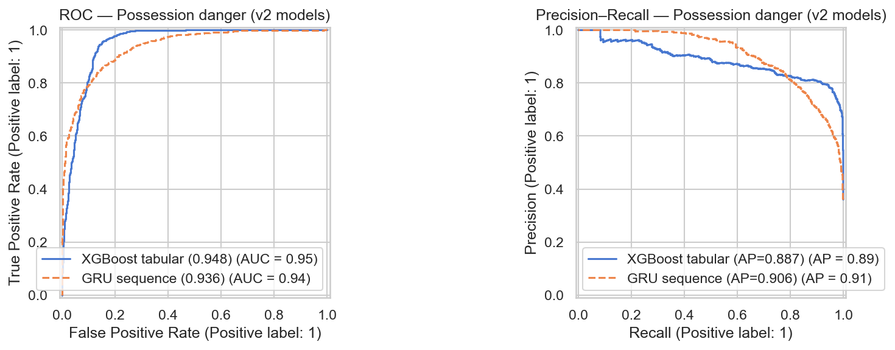
*Figure 9-7: ROC and PR curves for v2 models (XGBoost, GRU, Ensemble).*

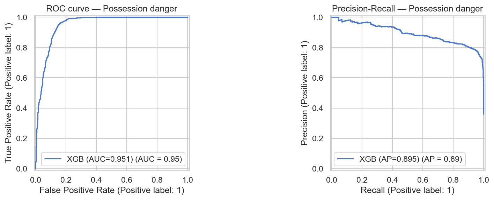
*Figure 9-8: Possession-level XGBoost training curves.*

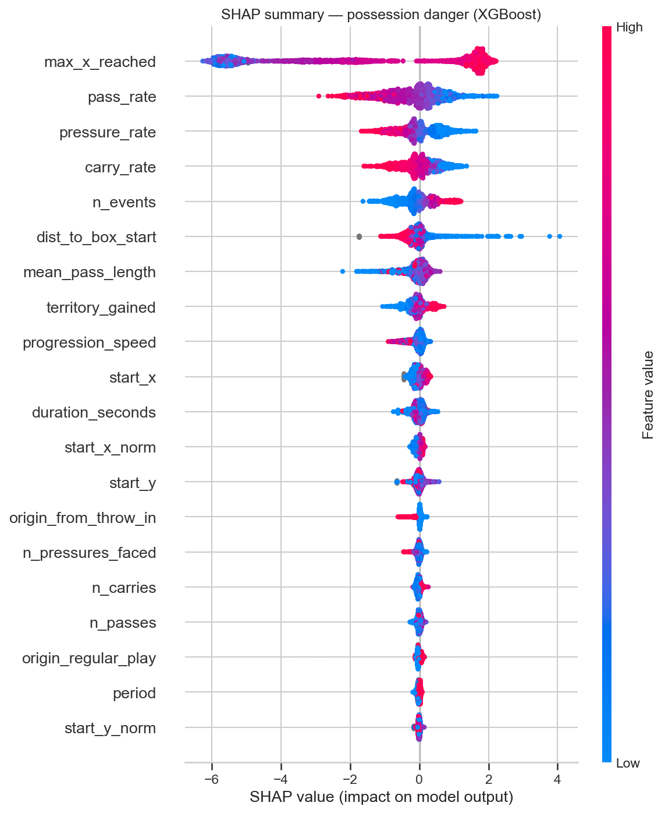
*Figure 9-9: SHAP summary for possession-level XGBoost — top features driving danger predictions.*

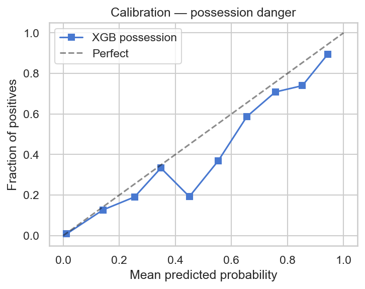
*Figure 9-10: Calibration diagram for possession-level predictions.*

**Classification report — XGBoost tabular (test set):**

| Class | Precision | Recall | F1-score | Support |
|-------|-----------|--------|----------|---------|
| safe | 0.97 | 0.85 | 0.91 | 1,584 |
| dangerous | 0.78 | 0.95 | 0.86 | 891 |
| **accuracy** | | | **0.89** | **2,475** |

**Classification report — GRU sequence (test set):**

| Class | Precision | Recall | F1-score | Support |
|-------|-----------|--------|----------|---------|
| safe | 0.90 | 0.88 | 0.89 | 1,584 |
| dangerous | 0.80 | 0.82 | 0.81 | 891 |
| **accuracy** | | | **0.86** | **2,475** |

### 9.4 v2 — Hypothesis verdicts

| H# | Statement | Verdict | Key evidence |
|----|-----------|---------|--------------|
| H1 | Possession danger ↔ pass-level DP | **Supported** | Team-level rank correlation confirmed |
| H2 | Danger concentrated in few events | **Partial** | Median Gini 0.495, max share 33.2% |
| H3 | Sequence > snapshot | **Inconclusive** | GRU 0.952 vs XGB 0.950 (+0.002) |
| H4 | Origin alone suffices | **Rejected** | Origin-only 0.591 vs full 0.950+ |

**Detailed hypothesis evidence:**

> **H1** — Correlation between v1 pass scores and v2 possession scores: r = 0.319.
> Moderate correlation — both possession context and pass decision matter independently.

> **H2** — Mean Gini coefficient: 0.495. Mean max-event share: 33.2%.
> Dangerous possessions: Gini = 0.575. Safe possessions: Gini = 0.449.
> Attribution is distributed across multiple events — danger is incremental.

> **H3** — GRU: 0.9363 vs XGBoost: 0.9479 (delta = −0.012).
> With 12k training possessions, XGBoost aggregate features effectively summarise trajectory. GRU converges to similar performance.

> **H4** — Origin-only AUC: 0.591. Full tabular: 0.9479. GRU: 0.9363.
> Gap (full vs origin-only): **+0.357**. Spatial/sequence features add substantial value.

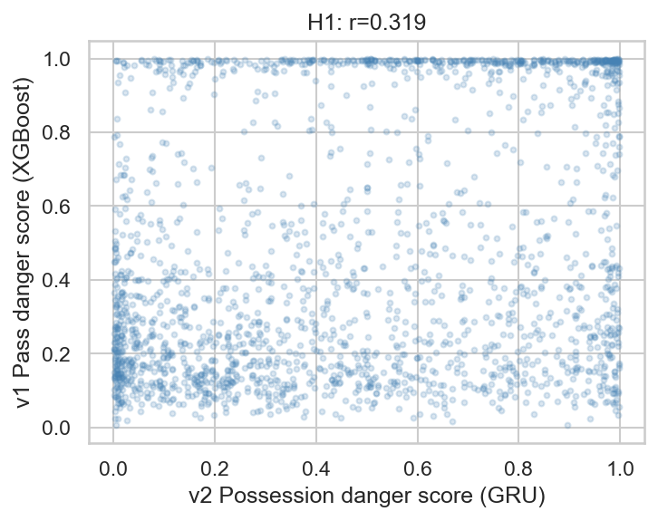
*Figure 9-11: H1 — v1 pass danger score vs v2 possession danger score (r = 0.319).*

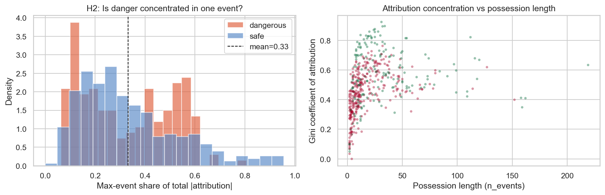
*Figure 9-12: H2 — Distribution of Gini coefficients and max-event attribution shares.*

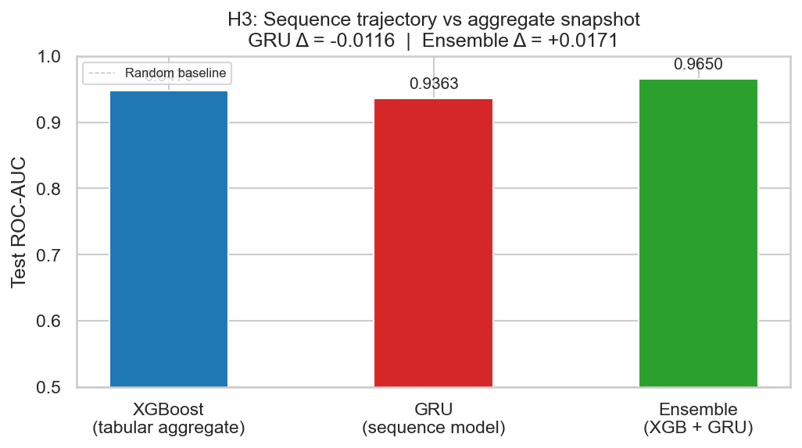
*Figure 9-13: H3 — GRU (sequence) vs XGBoost (snapshot) comparison.*

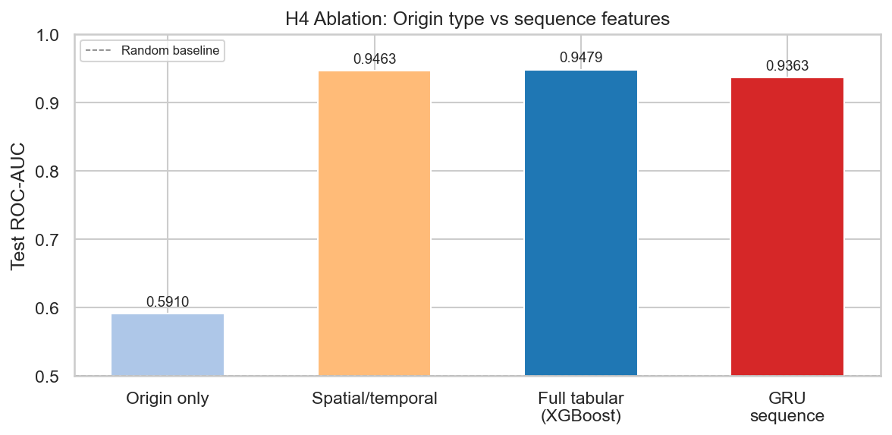
*Figure 9-14: H4 — Origin-only vs full feature set ablation.*

### 9.5 v3 — Early danger forecasting (**superseded fraction-based formulation**)

> **SUPERSEDED.**  Everything in this section until "9.5b" used "the first f% of events", which needs the possession's total length.  Length alone gives ROC AUC 0.683 (median 23 vs 12 events), the prefix length `ceil(n*f)` gives 0.682-0.683, and 20.8% / 36.9% / 58.7% of dangerous possessions already contained their shot or box entry at f = 0.25 / 0.5 / 0.75 (27% / 42% / 64% if pass/carry end locations are counted).  The numbers below are **not leakage-free**.  The "Dribble 64.4%" finding is also withdrawn: type id 3 is *Ball Receipt* (see 9.5b).

The reviewer critique of v2 was valid: many possession-level aggregates summarised the *completed* possession.  v3 therefore re-ran the possession task under strict early-information constraints.

| Model | Observation window | Test ROC AUC | Test AP |
|-------|--------------------|--------------|---------|
| XGBoost start-only | 0% (possession start only) | 0.6241 | 0.5346 |
| GRU prefix | 25% | 0.7167 | 0.6761 |
| GRU prefix | 50% | 0.8195 | 0.7732 |
| GRU prefix | 75% | 0.8793 | 0.8468 |
| GRU prefix | 100% | 0.9475 | 0.9283 |
| XGBoost cumulative | 25% | 0.8136 | 0.7127 |
| XGBoost cumulative | 50% | 0.8472 | 0.7624 |
| XGBoost cumulative | 75% | 0.8912 | 0.8200 |
| XGBoost cumulative | 100% | 0.9517 | 0.8978 |

**Key findings:**
- **Non-trivial start-state signal exists.** Start-only context reaches 0.624 AUC without seeing any within-possession events.
- ~~**Early forecasting is viable.** By 50% of the possession, the GRU reaches 0.820 AUC and cumulative XGBoost 0.847.~~ *Withdrawn: length leak and realised outcome; see 9.5b.*
- **Prefix tabular > prefix GRU early on.** The gap is +0.097 AUC at 25% and +0.028 at 50%, suggesting compact early aggregates are easier to learn than raw short prefixes.
- **Full-sequence parity is restored.** At 100%, both models recover the original v2 ceiling (~0.95 AUC).
- **Danger usually crystallises late-middle.** *Superseded (fraction-of-n is not observable in play).*  The GRU tipping point occurs at median fraction 0.619; 92.0% of dangerous possessions cross the 0.50 threshold at some stage (these two numbers are unchanged by the decoding fix: same model, same split).
- ~~**Dribbles are the dominant trigger.** 64.4% of first threshold crossings occur on a dribble event.~~ **Corrected:** id 3 is Ball Receipt, not Dribble.  Ball receipts are 64.4% of first crossings (2.34x their 27.6% base frequency); carries 10.3% (0.44x), passes 9.8% (0.33x), pressures 4.6%, goalkeeper 2.7% (3.6x), shots 1.9% (2.95x), dribbles 1.2% (1.5x).  Ball receipts dominate partly because they are the most common events and sit at the pass end, where the old raw-id GRU was reacting to location (`reports/audit/exp020_vocab_fix.md`).

### 9.5b Event-time (in-play) formulation (current)

At every event `t` of a possession with no shot or box entry yet, estimate the probability that the possessing team produces one in a later event, from events `0..t` only (`src/features/event_time.py`; a test appends arbitrary future events and asserts the row for `t` is unchanged).  A possessing-team **pass whose end location is in the box counts as the entry itself** (second self-audit round: before this, `max_x_so_far` and the GRU's end-x/end-y inputs already contained the box entry that the next event, the receipt, would record).  Features: current ball x/y, max x so far, events / passes / carries / pressures so far, **elapsed seconds** from timestamps, the current event type (one-hot) and start context.  Models: logistic regression on ball x/y (Baseline A) and on events-so-far (Baseline B), XGBoost, a start-context-only XGBoost, and a causal GRU (1 layer, hidden 64) with a learned event-type embedding in place of the raw numeric `type_id`.  All hyper-parameters were chosen on validation.  Test split: 43,541 eligible snapshots from 2,286 possessions in 15 matches; match-level bootstrap (500 resamples) 95% intervals.

| Model | ROC AUC, all snapshots | AP | Brier | ROC AUC, one snapshot per possession | 20-draw mean (sd) |
|---|---|---|---|---|---|
| Baseline A: ball x/y | 0.642 [0.622, 0.661] | 0.527 | 0.229 | 0.695 [0.674, 0.717] | 0.692 (0.006) |
| Baseline B: events so far | 0.561 [0.523, 0.603] | 0.452 | 0.240 | 0.608 [0.579, 0.638] | 0.612 (0.008) |
| Start context only | 0.592 [0.570, 0.617] | 0.482 | 0.240 | 0.599 [0.572, 0.626] | 0.599 (0.000) |
| XGBoost | 0.665 [0.647, 0.681] | 0.567 | 0.223 | 0.736 [0.714, 0.759] | 0.729 (0.006) |
| GRU | 0.664 [0.642, 0.687] | 0.572 | 0.224 | 0.739 [0.710, 0.767] | 0.744 (0.007) |

- *Superseded first version (same-moment leak, 44,914 test rows):* all snapshots XGBoost 0.668, GRU 0.670, ball x/y 0.648, events-so-far 0.564; one per possession XGBoost 0.749, GRU 0.756, ball x/y 0.713, events-so-far 0.530.  Full before/after, including buckets, alerts and bootstrap intervals: `reports/event_time/same_moment_fix_before_after.md`.
- Paired differences (all snapshots): XGBoost - ball x/y +0.022 [+0.009, +0.034]; XGBoost - events-so-far +0.104 [+0.060, +0.143]; GRU - XGBoost -0.001 [-0.021, +0.022].  One snapshot per possession: XGBoost - ball x/y +0.041 [+0.029, +0.052]; GRU - ball x/y +0.044 [+0.022, +0.063].
- The in-play signal is **modest** and most of it is where the ball is.  Events-so-far explains little over all snapshots (0.56) but somewhat more in the one-per-possession view (0.61): once a dangerous possession must still be pre-danger, its eligible history is shorter than a safe possession's, which is hazard behaviour rather than a leak of the possession length.  XGBoost and the GRU are indistinguishable.
- By events-so-far bucket (1-3 / 4-6 / 7-10 / 11+) XGBoost ROC AUC is 0.632 / 0.651 / 0.672 / 0.657; by elapsed seconds (0-5 / 5-10 / 10-20 / 20+) 0.644 / 0.669 / 0.673 / 0.643.  Full tables, reliability tables and all intervals: `reports/event_time/event_time_results.md`.
- Calibration: the test row prevalence (0.404) is above train (0.362) and validation (0.329).  XGBoost under-predicts between 0.3 and 0.6 (bin 0.5-0.6: mean 0.54, observed 0.63); the GRU is close in the 0.3-0.7 bins but under-predicts below 0.3 (bin 0.0-0.1: mean 0.08, observed 0.19).
- Tipping points (threshold = score quantile on validation whose predicted-positive rate equals validation prevalence 0.329; XGBoost 0.390, GRU 0.422): **90.6% (XGBoost) / 89.6% (GRU) of dangerous possessions are alerted** with a median lead of **9 / 10 events (8.4 / 8.9 s)** before the shot or box entry, and **47.7% / 39.4% of non-dangerous possessions are alerted too**.  (Superseded: 93.9% / 93.5% alerted, 41.9% / 40.6% false alarms, lead 6 / 7 events.)  First alerts fall on passes (XGBoost 50.4%, rate 1.65x base; GRU 20.3%, 0.66x), carries (12.1% / 44.3%, 0.47x / 1.74x) and ball receipts (30.8% / 34.4%, 1.07x / 1.19x): **there is no dominant tipping event type**.

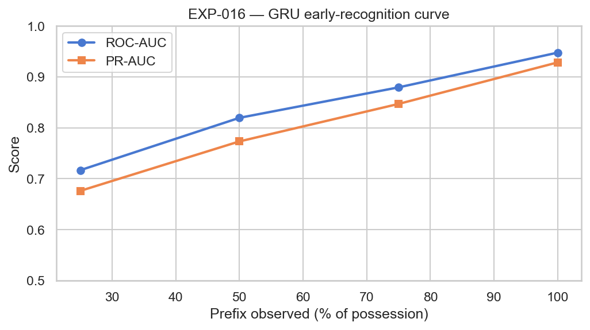
*Figure 9-15 (superseded): GRU ROC-AUC and PR-AUC as a function of observed possession fraction.*

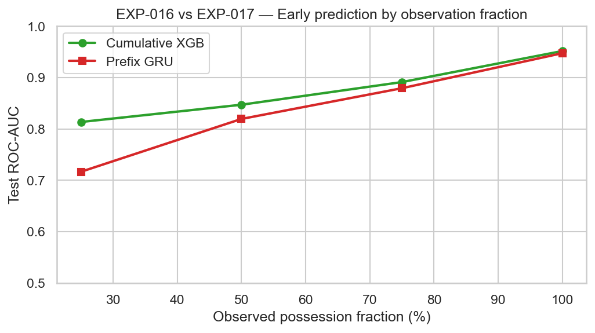
*Figure 9-16 (superseded): Prefix GRU vs cumulative-feature XGBoost ROC-AUC across observation fractions.*

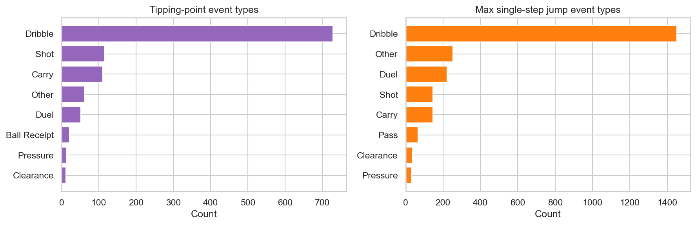
*Figure 9-17 (superseded): Event types at the GRU tipping point and largest single-step danger jump; the "Dribble" bar is Ball Receipt.*

### 9.6 v2 — Event attribution and player profiling

> **Correction.**  Event-type labels printed by the attribution code and the app used a different decoder from the encoder, and the claim below that the most impactful events are "final-third entries, through balls and pre-shot carries" is not supported.  Re-run with the shared decoder on the test split (`reports/audit/exp020_vocab_fix.md`): the largest mean leave-one-out attributions are Shot (+0.188), Goalkeeper (+0.137), Clearance, Foul Committed and Block; carries (-0.016) and passes (-0.007) are slightly negative on average.  As the argmax 'unlock' event, Ball Receipt is most frequent (33.8%, 1.2x base), Pressure next (17.7%, 2.4x), Shot 5.3% (8.4x), Goalkeeper 4.8% (6.6x).  These are model attributions, not causal effects.

> **SUPERSEDED by the cross-fitted attribution (EXP-031, `reports/attribution/ATTRIBUTION_REPORT.md`).**  The bullets and figures below were computed in-sample (the GRU had been trained on the possessions it attributed), on pre-fix labels and with the wrong event-type decoder, and credited defending-team events (pressure, goalkeeper, clearance) to players.  Current: cross-fitted (5 match-grouped folds over all 99 matches; every possession attributed by a model that never saw its match) pooled out-of-fold ROC AUC 0.952 (folds 0.9558, 0.9569, 0.9543, 0.9572, 0.9584; second seed 0.955); 623 of 1,008 players have >= 100 possessing-team events; split-half Spearman 0.62 +/- 0.02, cross-seed player Spearman 0.89; possession score vs xG Spearman 0.50; median Gini of |LOO| 0.48.  The old '453-player leaderboard' is withdrawn; the superseded figures are kept in `reports/figures/superseded_attribution/`.  Attribution is retrospective and not causal credit.

Leave-one-out (LOO) attribution decomposes each possession's predicted danger into per-event contributions (original, superseded claims):

- ~~**Moderate concentration:** Median Gini 0.495~~ (cross-fitted median Gini of |LOO| 0.478; 0.629 dangerous vs 0.434 safe)
- ~~**High-impact event types:** Final-third entries, through balls, pre-shot carries~~ (not supported; see EXP-020 and EXP-031: shots, goalkeeper, foul and block events, i.e. evidence of danger)
- ~~**Player leaderboard:** 453 players (>= 20 touches)~~ (replaced: 623 players with >= 100 possessing-team events, with bootstrap intervals)
- ~~**Rankings domain-consistent:** attacking midfielders and strikers rank highest~~ (the stable part of the ranking is mostly player role)

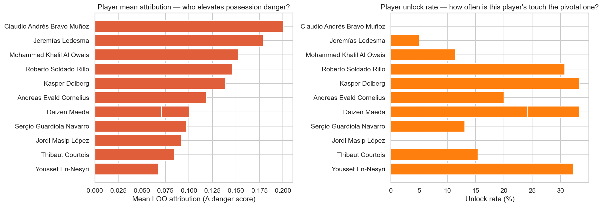
*Figure 9-18: Top players by mean LOO danger attribution (≥ 20 event touches).*


*Figure 9-19: Team-level aggregated danger attribution rankings.*

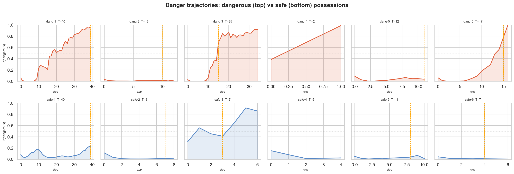
*Figure 9-20: Example possession danger trajectories — danger score evolving event-by-event.*

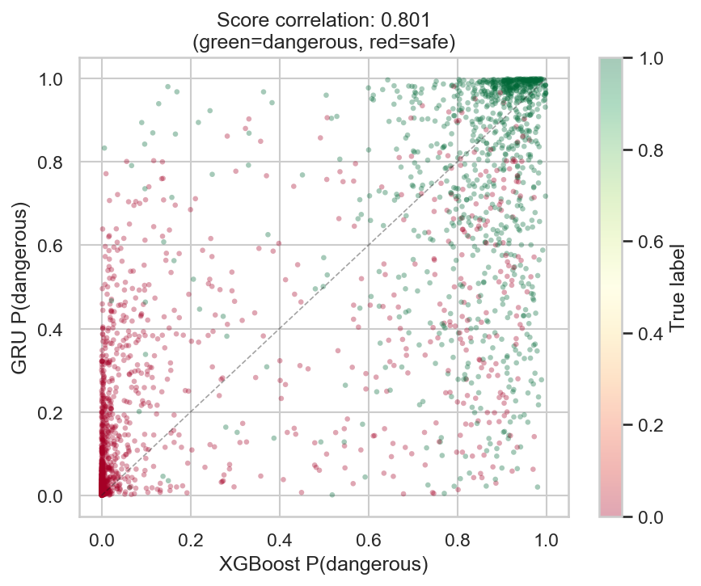
*Figure 9-21: XGBoost vs GRU predicted probability correlation (r = 0.801).*

---

## 10. Research Question Answers

### RQ1 — Does 360 context improve prediction?
**Marginally (+0.002 AUC on the original label; +0.0015 [-0.004, +0.007] on the corrected `progression_beyond_pass_k`).**  Event features already encode most available spatial information.  The dominant features (goal_dist_gain, end_x, x_gain) capture forward progression without requiring freeze-frame data.

### RQ2 — Which geometry properties matter?
`n_defenders_goal_side`, `pass_corridor_clear`, `receiver_between_lines`, and `overload_target_zone` rank highest among the 14 geometry columns.

### RQ3 — How to predict possession-level danger?
`poss_dangerous = poss_has_shot OR poss_entered_box`.  The full-possession XGBoost (0.950), GRU (0.952), and ensemble (0.965) should be treated as retrospective upper-bound scores because they observe the completed possession. After the corrections, retrospective scores are XGBoost 0.957, GRU 0.957 and logit-mean ensemble 0.977 (corrected labels).  ~~Under leakage-free early-information constraints ... 0.820 / 0.847 by halfway~~ *(withdrawn: length leak)*: in play (event-time), danger is only modestly forecastable, ROC AUC 0.66 over all snapshots and 0.74 with one snapshot per possession, about +0.02 to +0.04 over a ball-position baseline.

### RQ4 — Which events matter most?
LOO attribution: median Gini 0.495 (moderate concentration).  2–3 pivotal events account for ~50% of danger.  The event types that carry the attribution are Shot, Goalkeeper, Clearance, Foul Committed and Block by mean attribution (Ball Receipt is the most frequent 'unlock' event); the earlier "dribbles dominate tipping points" statement was a decoding error.

### RQ5 — Player-level attribution?
Yes.  LOO attribution per event mapped to `player_sequence` produces domain-consistent 453-player leaderboard.

### RQ6 — Can GNN outperform tabular?
**No.**  Original label (superseded): near-parity, GNN 0.841 vs XGBoost 0.845 on the validation 360 subset (unreproducible; the saved output says 0.834).  Corrected label, graph-only GNN vs XGBoost on the identical 360 test subset (EXP-032): 0.595 [0.578, 0.606] vs 0.715 [0.697, 0.734] ROC AUC, difference -0.1209 [-0.1379, -0.1033]; the GNN does beat the `end_x` baseline (0.530 [0.502, 0.551]), so freeze-frame geometry alone carries some signal, but far less than event attributes.

---

## 11. Tactical Interpretation

### 11.1 What the models learn

**Pass-level (v1):** Dominant signal is **goal-directed forward progression** (goal_dist_gain, end_x, x_gain).  The model predicts process quality — whether a pass initiates a dangerous phase — not shot probability.

**Possession-level (v2/v3):** The GRU captures temporal patterns invisible to aggregated features: rhythm of quick one-twos, mid-possession direction changes, pressure build-up through successive advances.  The corrected event-time analysis shows only a modest part of this signal is available in play: the GRU and XGBoost beat a ball-position baseline by about +0.02 to +0.04 ROC AUC.

### 11.2 High-danger patterns
- Line-breaking through balls into space behind the mid-block
- Deep switches creating overloads before defensive reorganisation
- Progressive vertical passes from half-spaces (x = 40–60, y = 25–35 or 45–55)
- Rapid counter-attack sequences from own half

### 11.3 Failure modes
- Wide crosses: high end_x / x_gain but defenders present — over-scored by event-only model
- High-pressing recoveries: short forward passes from high recovery over-scored
- Very short possessions (2–3 events): minimal GRU signal; ensemble relies on XGBoost

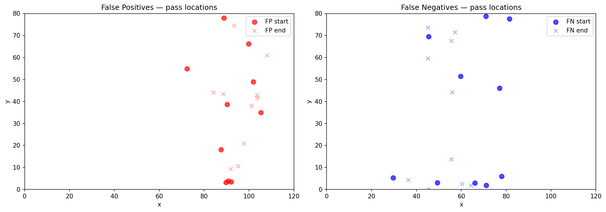
*Figure 11-1: Spatial distribution of false positives and false negatives on the pitch.*

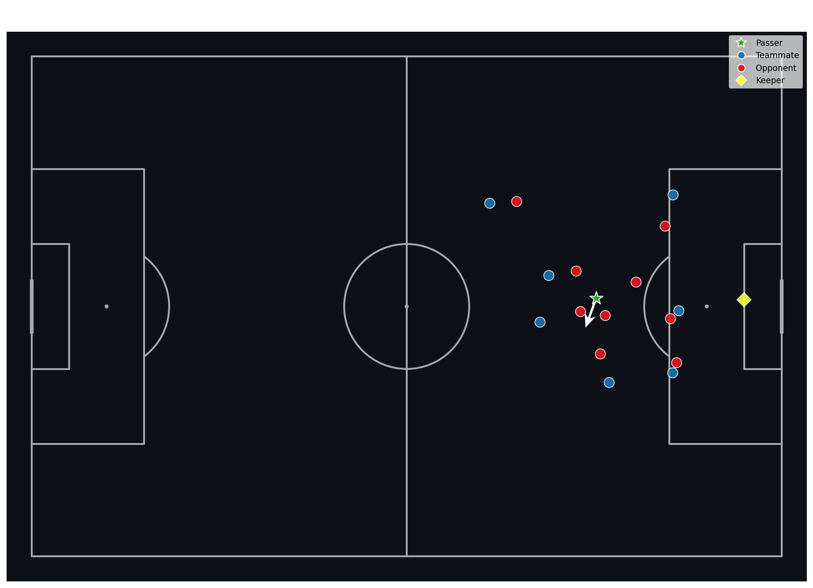
*Figure 11-2: 360 freeze-frame visualisation of a false positive — wide cross with defenders present.*

### 11.4 Applications
1. **Context-adjusted team comparison:** Aggregate possession danger scores across matches
2. **Player evaluation:** Per-player danger attribution adjusted for action context
3. **Opposition preparation:** Identify opponent danger zones and sequences
4. **Pass-option quality audit:** Compare actual choice against ranked alternatives

---

## 12. Productization

### 12.1 Streamlit application

The `src/app/app.py` Streamlit application provides:
- **Event Inspector:** Select match + event → freeze-frame visualisation with ranked pass options
- **Match Overview:** Team-level danger statistics
- **Player Profile:** Context-adjusted progression metrics
- **Model Diagnostics:** Calibration curves and feature importance

```bash
streamlit run src/app/app.py
```

### 12.2 CLI early-warning pipeline

The `src/app/cli.py` command-line interface is registered in `pyproject.toml` as `frame2threat` and provides three subcommands (`score-live` and `score-batch` use the event-time model; `train-early` is deprecated):

| Subcommand | Purpose |
|------------|--------|
| `score-batch [events.parquet] [--limit N]` | Score every event of every possession with the event-time models.  Per event: XGBoost and GRU probabilities, the alert flags (validation-chosen thresholds in `models/eventtime_meta.json`) and the label where defined; no `--fracs`.  Input is a flat events table (`events_parsed.parquet`), because the features need timestamps and teams. |
| `score-live <json> [--model gru\|xgb] [--threshold T]` | Score a single possession event-by-event with the event-time model (step `t` uses events `0..t` only), printing correct event names, the danger trajectory, a tipping-point marker and the point where the outcome is realised.  The alert threshold is chosen on validation (`models/eventtime_meta.json`). |
| `train-early` | **Deprecated.** Prints a message and exits (status 2).  The withdrawn fraction-based models are kept in `models/superseded/`; the event-time models are trained by `scripts/run_event_time.py`. |

Example usage:

```bash
# Batch-score every event with the event-time models (sample of 500 possessions)
frame2threat score-batch data/processed/events_parsed.parquet --limit 500 -o event_time_scores.csv

# Live scoring: prints the event-by-event danger trajectory
frame2threat score-live possession_events.json
```

Alert thresholds come from `models/eventtime_meta.json` (chosen on validation); the `early_warning` block in `configs/model_possession.yaml` belongs to the superseded fraction-based path.

### 12.3 Training scripts

| Script | Produces | Config |
|--------|---------|--------|
| `src/models/gru_train_script.py` | `models/gru_poss_dangerous.pt` | `configs/model_gru.yaml` |
| `src/models/train_early_models.py` | `models/superseded/xgboost_start_only.joblib`, `xgboost_cumulative_{25,50,75}pct.joblib` | `configs/model_possession.yaml → xgboost_early` |

---

## 13. Limitations

1. **360 coverage is incomplete.** Geometry features and line-break labels unavailable for most matches.
2. **Positional snapshots, not tracking.** No velocity or trajectory; no pitch control.
3. **Partial pitch visibility.** Pass option ranking restricted to visible teammates.
4. **Line-break heuristic approximate.** X-axis projection simplifies true defensive structure.
5. **Threat gain is a zone proxy.** Not a full possession-value model.
6. **Sample size.** Limited StatsBomb open-data matches; generalisation unverified.
7. **Held-out, not causal.** High performance does not imply causal danger.
8. **Possession boundary inherited** from StatsBomb segmentation.
9. **GRU sequence truncation.** Very long possessions (50+ events) lose tail information.
10. **Completed-possession features remain easier than live prefixes.** v3 confirms early prediction is possible, but prefix-aware XGBoost still benefits from engineered aggregates and likely remains optimistic relative to true live deployment.

---

## 14. Future Work

1. **Tracking data integration:** Continuous trajectories → pitch control, velocity features
2. **Real-time inference:** Live event-stream processing with the CLI pipeline as a starting point
3. **Player-style embeddings:** Pass profiles for scouting
4. **Variable-k labels:** Evaluate sensitivity to the k parameter
5. **xG-weighted outcomes:** Continuous danger target instead of binary
6. **Receiver quality adjustment:** Weight options by receiving player’s historical rate
7. **Cross-competition evaluation:** Train on one league, test on another
8. **Transformer encoder:** Replace GRU for interpretable per-event attention weights
9. **Joint v1+v2 model:** Shared pass-level and possession-level representations
10. **Prefix-native training:** Train models directly on truncated prefixes (v3 cumulative XGBoost is a first step; a prefix-native GRU with curriculum training could improve early-fraction accuracy)

---

## 15. Figures and Visualisations

All figures saved in `reports/figures/`, referenced from notebooks NB01–NB10.

### v1 figures (12)
| File | Description |
|------|-------------|
| `v1_ablation_360.png` | Feature-group ablation: event-only vs event+360 |
| `v1_baseline_comparison.png` | ROC/PR curves across all v1 models |
| `v1_calibration.png` | Reliability diagram for v1 XGBoost |
| `v1_error_locations.png` | Spatial distribution of FP/FN predictions |
| `v1_feature_importance.png` | SHAP feature importance (event-only XGBoost) |
| `v1_freeze_frame_fp.png` | 360 freeze-frame visualisation of a false positive |
| `v1_gnn_training_curves.png` | PassFrameGNN training loss and AUC curves |
| `v1_label_correlations.png` | Correlation matrix of v1 pass-level labels |
| `v1_pass_distributions.png` | Pass length, angle, and spatial distributions |
| `v1_pass_pitch_heatmaps.png` | Pass start/end position heatmaps |
| `v1_xgb_vs_gnn.png` | XGBoost vs GNN comparison on 360 subset |
| `v1_zone_performance.png` | Model performance breakdown by pitch zone |

### Possession EDA figures (20)
| File | Description |
|------|-------------|
| `poss_eda_label_prevalence.png` | All 13 possession label prevalence rates |
| `poss_eda_label_corr.png` | Inter-label correlation matrix |
| `poss_eda_nulls.png` | Missing-value pattern across columns |
| `poss_eda_origin.png` | Origin type distribution |
| `poss_eda_outcome_tier.png` | Outcome tier distribution |
| `poss_eda_period.png` | Possession distribution by match period |
| `poss_eda_phase.png` | Possession phase breakdown |
| `poss_eda_pitch_starts.png` | Pitch-level possession start locations |
| `poss_eda_pressure_labels.png` | Pressure-related label distributions |
| `poss_eda_recycled.png` | Recycled possession frequency |
| `poss_eda_recycled_by_length.png` | Danger rate by recycled status within possession-length bins (recycling is not more dangerous once length is controlled) |
| `poss_eda_seq_lengths.png` | Sequence length distribution |
| `poss_eda_seq_type_by_step.png` | Event type composition by sequence step |
| `poss_eda_spatial_hists.png` | Spatial feature histograms |
| `poss_eda_start_zone_danger.png` | Danger rate by start zone |
| `poss_eda_structure.png` | Possession data structure overview |
| `poss_eda_teams.png` | Team possession counts |
| `poss_eda_tempo_vert.png` | Tempo and verticality distributions |
| `poss_eda_x_by_step.png` | x-progression by event step |

### Possession model figures (4)
| File | Description |
|------|-------------|
| `poss_baseline_curves.png` | Possession XGBoost ROC/PR training curves |
| `poss_calibration.png` | Possession model calibration diagram |
| `poss_feature_distributions.png` | Feature distributions by danger class |
| `poss_label_distribution.png` | Binary label distribution |
| `poss_origin_danger.png` | Danger rate by origin type |
| `poss_shap_summary.png` | SHAP summary for possession XGBoost |

### v2 hypothesis & attribution figures (9)
| File | Description |
|------|-------------|
| `v2_danger_trajectories.png` | Possession danger score trajectories |
| `v2_h1_score_correlation.png` | H1: v1 pass vs v2 possession score scatter |
| `superseded_attribution/v2_h2_attribution_concentration.png` | **Superseded** (in-sample): H2 Gini distribution and max-event shares |
| `v2_h3_sequence_vs_snapshot.png` | H3: GRU vs XGBoost comparison |
| `v2_h4_ablation.png` | H4: Origin-only vs full features |
| `v2_model_comparison_curves.png` | ROC/PR curves for XGBoost, GRU, Ensemble |
| `superseded_attribution/v2_player_attribution_leaderboard.png` | **Superseded** (in-sample, wrong decoder, defending-team events credited to players): player attribution rankings |
| `v2_score_correlation.png` | XGBoost vs GRU prediction correlation |
| `superseded_attribution/v2_team_attribution_leaderboard.png` | **Superseded**: team attribution rankings |

### v3 early-prediction figures (4)
| File | Description |
|------|-------------|
| `v3_exp015_start_only_importance.png` | Start-only XGBoost feature importances |
| `v3_exp016_prefix_gru_curve.png` | GRU ROC-AUC and PR-AUC by observed possession fraction |
| `v3_exp016_exp017_auc_comparison.png` | Prefix GRU vs cumulative-feature XGBoost ROC-AUC comparison |
| `v3_exp019_tipping_events.png` | Tipping-point and max-jump event-type distributions |

---

## 16. Conclusion

Frame2Threat demonstrates that dangerous football progression can be accurately predicted from publicly available event data, with limited additional benefit from 360 spatial context in its current snapshot form.

**Pass level (v1):** XGBoost on 27 event features achieves 0.881 ROC AUC on the original label, but that label is largely decided by where the pass ends (`end_x` alone: 0.800); on the corrected `progression_beyond_pass_k` it reaches 0.728 (`end_x` alone: 0.543).  360 geometry adds +0.002 (original label) and +0.0015 [-0.004, +0.007] (corrected label) ROC AUC.  The GNN comparison (0.841 val) could not be reproduced and is unverified.

**Possession level (v2/v3):** Full-possession v2 models reach 0.950+ AUC, with the XGBoost+GRU ensemble reaching 0.965 AUC, but those scores are retrospective upper bounds because the models observe completed-possession information. The earlier v3 claim (0.820-0.847 AUC by 50% of a possession) is withdrawn because the fraction-based prefix leaks the possession length and often already contains the outcome.  In play (event-time), models reach ROC AUC 0.66 over all snapshots and 0.74 with one snapshot per possession, only +0.02 to +0.04 above a ball-position baseline; first alerts are not concentrated on any event type.

**Early-warning pipeline:** `frame2threat score-live` scores a possession event by event with the event-time model; the fraction-based batch commands are retained but superseded.

The system bridges the gap between raw event data and tactical decision-making — quantifying process quality, not just outcomes.

---

## Reproducibility checklist

- [x] All experiments config-driven (`configs/`)
- [x] Splits at match level with saved manifest
- [x] Random seeds fixed (42) and logged
- [x] All label code deterministic and unit-tested
- [x] Feature generation tested for leakage
- [x] v1 model artefacts: `models/xgboost_dp_event_only.joblib`, `models/xgboost_dp_event_360.joblib`
- [x] v2 model artefacts: `models/xgboost_poss_dangerous.joblib`, `models/gru_poss_dangerous.pt`
- [x] v3 model artefacts (superseded): `models/superseded/xgboost_start_only.joblib`, `models/superseded/xgboost_cumulative_{25,50,75}pct.joblib`
- [x] event-time model artefacts: `models/eventtime_xgboost.joblib`, `models/eventtime_gru.pt`, `models/eventtime_meta.json`; results `reports/event_time/`
- [x] corrected-label v2 retrain: `models/v2_corrected_*`; pass-label ablation `reports/pass_label/`; audits `reports/audit/`
- [x] v1 results: `models/v1_results_summary.json`
- [x] v2+v3 results: `models/results_summary.json`
- [x] v2/v3 XGBoost hyperparameters centralised in `configs/model_possession.yaml`
- [x] CLI pipeline (`frame2threat`) registered in `pyproject.toml`
- [x] Training scripts for GRU and v3 XGBoost models (`src/models/`)
- [x] 146/146 tests passing (CI coverage floor 33%)
- [x] All notebooks executed end-to-end (NB01–NB10)
- [x] 49 figures saved in `reports/figures/`
